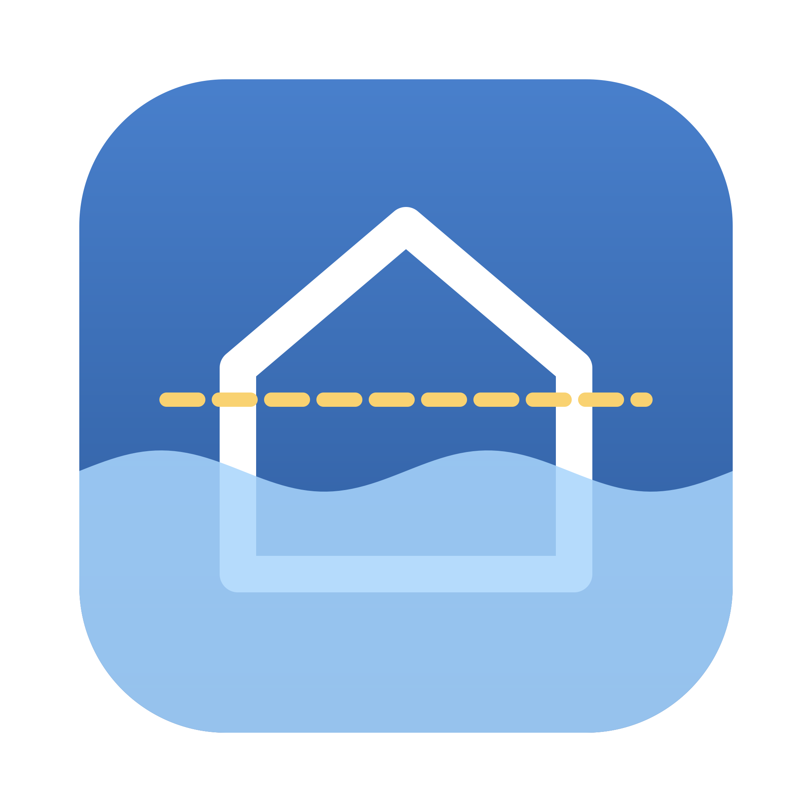
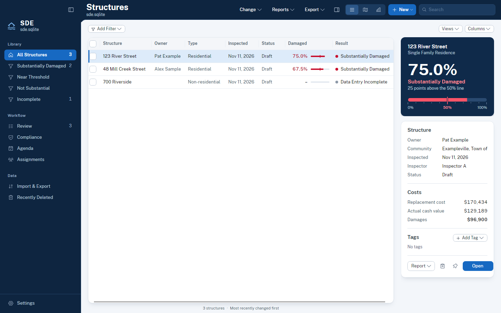
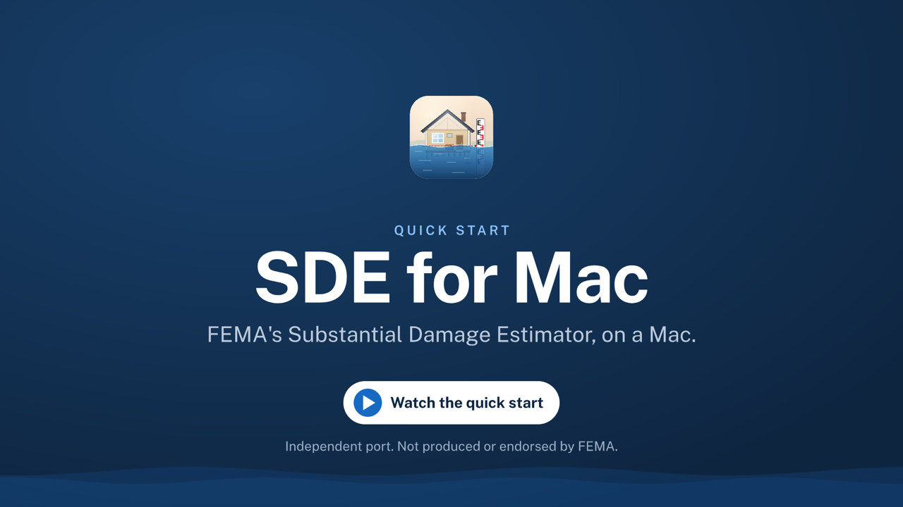

# SDE for Mac



**FEMA's Substantial Damage Estimator, on a Mac.** After a flood or other disaster, communities in the National Flood
Insurance Program have to decide whether each damaged building is *substantially damaged*: whether repairing it would
cost 50 percent or more of its value before the damage. FEMA's Substantial Damage Estimator (SDE 3.0) is the standard
tool for that, and it runs only on Windows. SDE for Mac gives the same results and reads and writes the same files,
so you can trade files with offices that use FEMA's SDE.

It is for floodplain administrators, building officials, inspectors and consultants in any community, county or
state.

> **Not a FEMA product.** SDE for Mac is an independent, unofficial port. It is not produced, endorsed or supported by
> FEMA. It uses FEMA's calculation, cost tables and validation rules and is tested against FEMA's own engine, but every
> determination remains the responsibility of the local floodplain administrator.

<picture>
  <source media="(prefers-color-scheme: dark)" srcset="docs/screenshots/40-dark-structures.png">
  
</picture>

**[Download the latest release](../../releases/latest)** · [User guide](docs/USER-GUIDE.md) ·
[Quick start video](docs/video/sde-for-mac-quick-start.mp4) · [What's new in 3.5](docs/WHATS-NEW-3.5.md) ·
[Report a problem](../../issues/new/choose)

## What it does
- **Assessments in eight short steps.** The result updates as you type, with FEMA's validation rules and help beside
  each field.
- **FEMA's files.** It imports SDE export folders and `.mdb` databases, exports folders that FEMA's SDE imports, and
  prints FEMA's reports as PDFs.
- **Your own data.** Import inspections or parcels from a permit system, assessor roll or spreadsheet, match photos to
  structures, and let inspectors fill in assessments from a phone.
- **A map and events.** Work on a map with your own layers and FEMA's flood zones, and keep each disaster separate.
- **Field and office work.** Field teams and work packages, a review queue, a compliance tracker and owner letters.
- **Safety nets.** Finished assessments lock, every edit is kept in the history, and backups run daily. AI assistants
  can read a database, and change it only when you allow it.

The [user guide](docs/USER-GUIDE.md) covers all of it, including substantial improvement, appeals and cumulative
damage.

## Install
You need a Mac with **macOS 12 Monterey or later** (Apple silicon or Intel) and about 200 MB of disk space.

1. **Download.** Open the [latest release](../../releases/latest) and, under **Assets**, download
   `SDE-<version>-osx-arm64.zip` for Apple silicon (M1 or newer) or `SDE-<version>-osx-x64.zip` for Intel.
   **Apple menu > About This Mac** shows which you have.
2. **Install.** Double-click the zip, then drag **SDE** into your **Applications** folder.
3. **Open it.** Double-click **SDE** in Applications. If macOS says it can't check SDE for malicious software, click
   **Done**, open **System Settings > Privacy & Security**, scroll to **Security**, click **Open Anyway** and confirm
   with your password or Touch ID. This happens once.
4. **Take the short walkthrough** that appears the first time. It ends with an offer to open the sample database.

An internet connection is needed only for online maps, layers and look-ups. SDE checks for updates only when you choose
**Help > Check for Updates**, and installs nothing by itself.
[SECURITY.md](SECURITY.md#what-sde-sends-over-the-internet) lists what each online service receives.

<details>
<summary>Updating, uninstalling and checking the download</summary>

- **Updating.** Quit SDE and replace the app in Applications with the new release. Your databases, photos, settings
  and import profiles live outside the app and are kept. A new version opens databases from earlier versions, and the
  previous version can still open a database after a newer one has used it.
- **Uninstalling.** Drag SDE to the Trash. Your data stays where it is: the default database, its photos and its
  backups are in `~/Library/Application Support/SDE/`, and the log files are in `~/Library/Logs/SDE/`. Delete those
  folders only if you are sure you no longer need the assessments in them.
- **Checking the download.** Each release lists SHA-256 checksums in `SHA256SUMS`. In Terminal, run
  `shasum -a 256 ~/Downloads/SDE-*.zip` and compare the result with the line for your file.

</details>

## Quick start
A first session takes about 15 minutes. The video shows installing SDE and these seven steps in under two minutes.

[](docs/video/sde-for-mac-quick-start.mp4)

1. **Practice first.** Choose **Help > Open Sample Database**. It holds made-up buildings and never touches your own
   data.
2. **Make a database for your event.** Choose **File > New Database…** and save it in a folder named for the event,
   such as `2026-09 River flood`.
3. **Set it up once.** In **SDE > Settings…** (⌘,), type **Your name**, fill in **Defaults** with what every building
   in the event shares, and turn on **Fill new structures with my default values**.
4. **Assess a building.** Click **New** in the toolbar and choose **Residential Structure** (⌘N) or **Non-Residential
   Structure** (⇧⌘N), then work through the eight steps on the left. The percent damaged appears as soon as there is
   enough to calculate. Your work saves itself.
5. **Bring in what you already have.** **File > Import SDE Data…** (⌘I) reads data from FEMA's SDE. **File > Import
   Inspections or Parcels…** (⇧⌘I) reads a permit system, a spreadsheet or an assessor roll.
6. **Review and finish.** When an assessment has been checked, set its status to **Final**. That locks it.
7. **Send the results.** In Structures, click **Export** and choose **Submission Folder…**. You get a PDF report for
   each building, the list reports, the FEMA package (`SDE_1`) and a spreadsheet of results.

## Getting help
- **In the app:** the **?** beside a field explains it and names the page of FEMA's SDE User Manual. **Help > SDE
  Help** searches the field help.
- **Substantial damage rules** (what counts, your ordinance, appeals): ask your state's NFIP coordinator or your FEMA
  regional office. FEMA's *Substantial Improvement/Substantial Damage Desk Reference* (FEMA P-758) is the main
  reference.
- **A problem with the app:** [open an issue](../../issues/new/choose) and pick the form that fits. Never attach real
  owner names, addresses, photos or databases. Describe the building's values instead.
- **A security problem:** don't open a public issue. See [SECURITY.md](SECURITY.md).

## Documentation
**For users**
- [User guide](docs/USER-GUIDE.md): every task, step by step.
- [Importing inspections or parcels](docs/IMPORTING.md)
- [Owner letters](docs/LETTERS.md)
- [Phone form](docs/PHONE-FORM.md)
- [AI assistants (MCP)](docs/MCP.md)
- What's new in [3.5](docs/WHATS-NEW-3.5.md), [3.0](docs/WHATS-NEW-3.0.md), [2.5](docs/WHATS-NEW-2.5.md) and
  [2.0](docs/WHATS-NEW-2.0.md)

**For developers and reviewers**
- [How FEMA's SDE works](docs/SDE-ARCHITECTURE.md)
- [Porting notes](docs/PORTING-NOTES.md): every difference from the original.
- [Test report](docs/TEST-REPORT.md): what the tests establish, and what they don't.
- [Online services](docs/ONLINE-SERVICES.md)
- [Windows cross-check kit](docs/windows-crosscheck/README.md): compare results with FEMA's SDE on Windows.
- [Releasing](docs/RELEASING.md): building, signing and publishing the app.
- [Design language](docs/design/DESIGN-LANGUAGE.md)

## Building from source
You need the .NET 10 SDK (`brew install dotnet`, or from Microsoft).

```bash
dotnet build Sde.sln
dotnet test Sde.sln
```

[CONTRIBUTING.md](CONTRIBUTING.md) covers the tools the tests need, the tests that compare this port with FEMA's own
engine, and where things are in the repository.

## Contributing, security and license
Contributions are welcome. Read [CONTRIBUTING.md](CONTRIBUTING.md) first, because results must stay identical to
FEMA's. Report security problems privately as described in [SECURITY.md](SECURITY.md). The code is under the
[MIT license](LICENSE), and third-party components are listed in [THIRD-PARTY-NOTICES.md](THIRD-PARTY-NOTICES.md).
