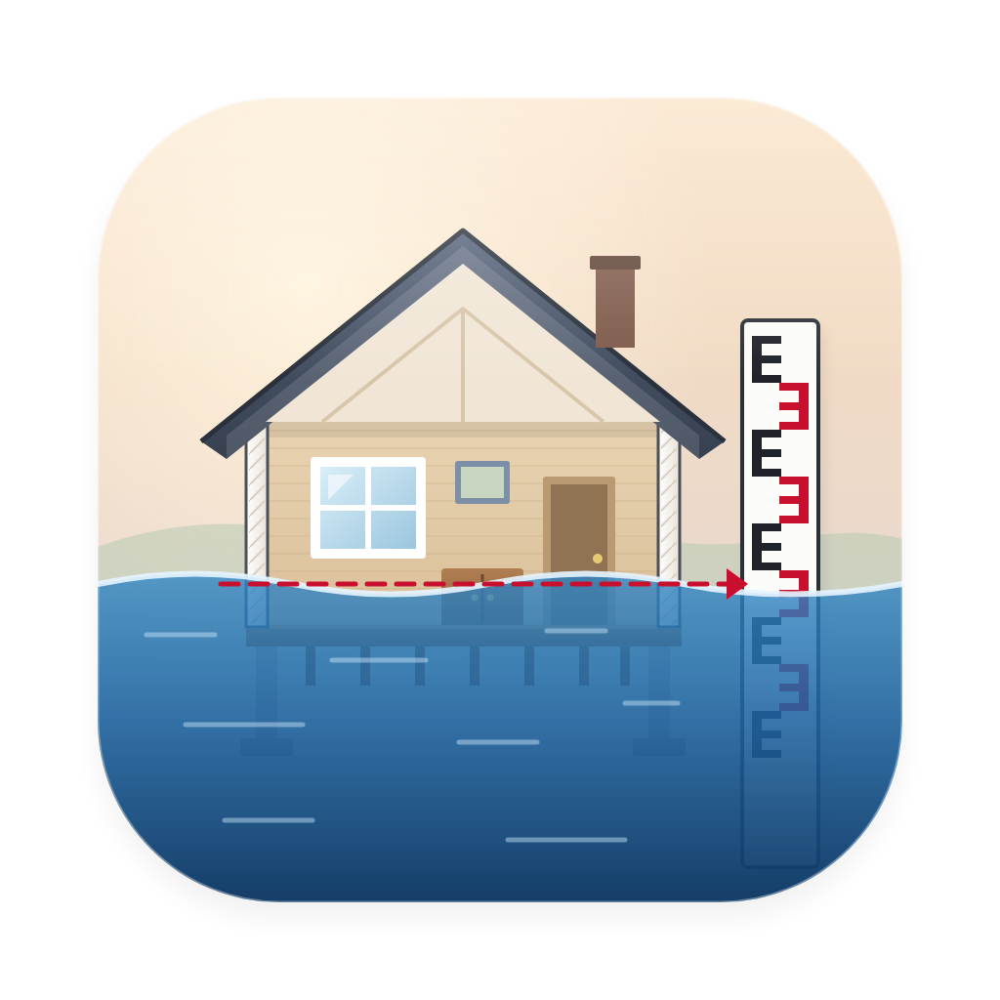

# SDE for Mac

**FEMA's Substantial Damage Estimator, on a Mac.** After a flood or other disaster, communities in the National Flood
Insurance Program have to decide whether each damaged building is *substantially damaged*: whether repairing it would
cost 50 percent or more of its value before the damage. FEMA's Substantial Damage Estimator (SDE 3.0) is the standard
tool for that, and it runs only on Windows. SDE for Mac gives the same results, reads and writes the same files, and
adds what an office needs during a busy recovery: events, a map you can edit, field teams and work packages, review
and compliance tracking, imports from permit systems and assessor rolls, owner letters, a phone form for inspectors,
AI assistants that work only as far as you allow, edit history and automatic backups.

> **Not a FEMA product.** SDE for Mac is an independent, unofficial port. It is not produced, endorsed or supported by
> FEMA. It uses FEMA's calculation, cost tables and validation rules and is tested against FEMA's own engine, but every
> determination remains the responsibility of the local floodplain administrator.

<picture>
  <source media="(prefers-color-scheme: dark)" srcset="docs/screenshots/40-dark-structures.png">
  
</picture>

**[Download the latest release](../../releases/latest)** · [User guide](docs/USER-GUIDE.md) ·
[What's new in 3.0](docs/WHATS-NEW-3.0.md) · [Report a problem](../../issues/new/choose)

## Contents
- [Who it's for](#who-its-for)
- [What it does](#what-it-does)
- [Finding your way around](#finding-your-way-around)
- [Install](#install)
- [Quick start](#quick-start)
- [User guide](#user-guide)
- [Getting help](#getting-help)
- [Building from source](#building-from-source)
- [Documentation](#documentation)
- [Contributing, security and license](#contributing-security-and-license)

## Who it's for
Floodplain administrators, building officials, inspectors and consultants who make substantial damage determinations
and work on Macs. It is built for any community, county or state: nothing in it is specific to one place, agency or
software vendor. If another office (or your state) uses FEMA's SDE on Windows, you can send files back and forth in
both directions.

## What it does
- **Assessments in eight short steps**, with the result updating as you type, FEMA's validation rules shown next to
  each field, and help for every field that names the page of FEMA's manual it comes from.
- **FEMA's files**: imports SDE export folders, SDE 2.x folders and FEMA `.mdb` databases; exports SDE_n folders that
  FEMA's SDE imports; prints FEMA's reports as PDFs.
- **Many structures at once**: sort, filter and save views; set one field on many structures; search and replace;
  copy from a similar building; write a submission folder with every report, the FEMA package and a results
  spreadsheet.
- **Data from the field**: import inspections or parcels from any permit system, assessor roll or spreadsheet (`.csv`,
  `.xlsx`, `.xls`, or a shapefile's `.dbf`); match a folder of photos to structures; look up coordinates and flood data
  online; let inspectors fill in assessments from a phone over the office Wi-Fi.
- **Events**: keep each disaster separate and look at one at a time; Structures, the map, the summary, exports and
  letters follow the event chosen in the sidebar.
- **A map you can work in**: layers from Shapefiles, GeoJSON, GeoPackages, CSV and ArcGIS services; styling, an
  attribute table, selecting, measuring, editing your own layers, copying values onto structures, printing, and FEMA's
  flood zones as an overlay.
- **Field work**: teams with routes, worksheets and a phone list; work packages to take assessments to a Mac with no
  connection and back; maps kept for offline use; flood depth from high-water marks; elevation certificates read from
  FEMA's form; photo markup.
- **Office work**: a review queue with quality checks and comments, a compliance and ICC tracker with letters, and web
  maps to share with partners or the public.
- **Results**: an event summary with a PDF version, GeoPackage and GeoJSON files for GIS, owner letters from Word
  templates, substantial improvement determinations, appeals with contractor bids, and optional cumulative damage.
- **AI assistants**: Claude and other assistants can read and check a database and make reports; they change it only
  when you allow it, and every change can be reverted.
- **Safety nets**: review statuses that lock finished assessments, edit history, undo, Recently Deleted, and automatic
  daily backups.

## Finding your way around
SDE 3.0 is laid out like other Mac apps. [What's new in 3.0](docs/WHATS-NEW-3.0.md) lists where everything from 2.5
moved.

- **The sidebar** lists your structures: **All Structures**, then smart groups (Substantially Damaged, Near
  Threshold, Not Substantial, Incomplete) with counts, each **event** in the database, the **Review**, **Compliance**
  and **Assignments** queues, and **Recently Deleted**.
- **The toolbar** switches Structures between **List**, **Map** and **Summary** (⌘1, ⌘2, ⌘3), makes new structures
  with the **New** pull-down, and searches the list.
- **The menus** hold everything else: databases and imports in **File**, the pages in **View** (⌘1 to ⌘8), events
  and the event summary in **Event**, and **Settings** in the SDE menu (⌘,).
- **The look follows your Mac**: light or dark, and the accent colour set in System Settings › Appearance.

## Install

### What you need
- A Mac with **macOS 12 Monterey or later**, either Apple silicon (M1 or newer) or Intel.
- About 200 MB of disk space for the app, plus room for your photos.
- An internet connection only for map backgrounds and the optional online look-ups. Everything else works offline.

### Step by step
1. **Check which kind of Mac you have.** Open the Apple menu (top-left corner) and choose **About This Mac**. If it says **Chip: Apple M1** (or
   M2, M3 and so on) you have Apple silicon. If it says **Processor** with **Intel** in it, you have an Intel Mac.
2. **Download the app.** Open the [latest release](../../releases/latest). Under **Assets**, download one zip:
   - `SDE-<version>-osx-arm64.zip` for **Apple silicon**, or
   - `SDE-<version>-osx-x64.zip` for **Intel**.
3. **Unzip it.** Double-click the zip in your Downloads folder. An app called **SDE**, with a flooded-house icon,
   appears next to it.
4. **Move it to Applications.** Drag **SDE** into the **Applications** folder in the Finder sidebar.
5. **Open it.** Double-click **SDE** in Applications (or press ⌘ Space, type `SDE`, press Return).
6. **If macOS blocks it.** Unless a release says it is signed with a Developer ID, macOS shows a message that it can't
   check SDE for malicious software. This happens once:
   1. Click **Done** (not *Move to Trash*).
   2. Open **System Settings** > **Privacy & Security**.
   3. Scroll down to **Security**. Next to the message about SDE, click **Open Anyway**.
   4. Enter your password or use Touch ID, then click **Open**.
7. **Take the short walkthrough** that appears the first time. It ends with an offer to open the sample database,
   which is the best place to try things.

**Optional: check the download.** Each release lists SHA-256 checksums in `SHA256SUMS`. In Terminal, run
`shasum -a 256 ~/Downloads/SDE-*.zip` and compare the result with the line for your file.

### Updating
Quit SDE, download the new release, and replace the old app in Applications with the new one. Your databases, photos,
settings and import profiles are kept, because they live outside the app. A new version opens databases from earlier
versions, and the previous version can still open a database after a newer one has used it.

### Uninstalling
Drag SDE from Applications to the Trash. Your data stays where it is: the default database, its photos and its
backups are in `~/Library/Application Support/SDE/`, and the log files are in `~/Library/Logs/SDE/`. Delete those
folders too only if you are sure you no longer need the assessments in them.

## Quick start
A first session takes about 15 minutes.

1. **Practise first.** Choose **Help > Open Sample Database**. It holds made-up buildings, shows a banner so you always
   know you are in it, and never touches your own data. Open a few structures and look around.
2. **Make a database for your event.** Choose **File > New Database…** and save it in a folder named for the event
   (for example `2026-09 River flood`). Keep one database per event.
3. **Set it up once.** Choose **SDE > Settings…** (⌘,). Type **Your name** (it goes into edit history), then fill in
   **Defaults** with what is the same for every building in this event: the community, FIRM panel information, cost data
   and so on. Turn on **Fill new structures with my default values**.
4. **Assess a building.** In **Structures** (⌘1), click **New** (+) in the toolbar and choose **Residential
   Structure** (⌘N) or **Non-Residential Structure** (⇧⌘N). Work through the eight steps on the left. The percent
   damaged appears on the right as soon as there is enough to calculate, and **To Check** lists anything still
   missing. Your work saves itself.
5. **Bring in what you already have.** If the data is in FEMA's SDE, choose **File > Import SDE Data…** (⌘I). If it
   is in a permit system, a spreadsheet or an assessor roll, choose **File > Import Inspections or Parcels…** (⇧⌘I).
6. **Review and finish.** When an assessment has been checked, set its status (the pop-up in the toolbar) to
   **Final**. That locks it against accidental changes.
7. **Send the results.** In Structures, click **Export** above the list and choose **Submission Folder…**. You get a
   PDF report for each building, the list reports, the FEMA package (`SDE_1`) for FEMA or your state, and a
   spreadsheet of results.

## User guide
The **[user guide](docs/USER-GUIDE.md)** explains every task step by step:

1. [How SDE is organised](docs/USER-GUIDE.md#1-how-sde-is-organised)
2. [Setting up for an event](docs/USER-GUIDE.md#2-setting-up-for-an-event)
3. [Adding structures](docs/USER-GUIDE.md#3-adding-structures)
4. [Assessing a structure, step by step](docs/USER-GUIDE.md#4-assessing-a-structure-step-by-step)
5. [Photos](docs/USER-GUIDE.md#5-photos)
6. [Reviewing, locking and undoing](docs/USER-GUIDE.md#6-reviewing-locking-and-undoing)
7. [Working with many structures](docs/USER-GUIDE.md#7-working-with-many-structures)
8. [Looking up locations and flood data online](docs/USER-GUIDE.md#8-looking-up-locations-and-flood-data-online)
9. [The map and the summary](docs/USER-GUIDE.md#9-the-map-and-the-summary)
10. [Reports and sending results to FEMA or your state](docs/USER-GUIDE.md#10-reports-and-sending-results-to-fema-or-your-state)
11. [Owner letters](docs/USER-GUIDE.md#11-owner-letters)
12. [Substantial improvement](docs/USER-GUIDE.md#12-substantial-improvement)
13. [Appeals and contractor bids](docs/USER-GUIDE.md#13-appeals-and-contractor-bids)
14. [Cumulative damage](docs/USER-GUIDE.md#14-cumulative-damage)
15. [The phone form](docs/USER-GUIDE.md#15-the-phone-form)
16. [AI assistants](docs/USER-GUIDE.md#16-ai-assistants)
17. [Backups, moving and sharing](docs/USER-GUIDE.md#17-backups-moving-and-sharing)
18. [Troubleshooting](docs/USER-GUIDE.md#18-troubleshooting)
19. [Keyboard shortcuts](docs/USER-GUIDE.md#19-keyboard-shortcuts)

## Getting help
- **In the app**: the **?** next to any field says what to enter and which page of FEMA's SDE User Manual covers it.
  **Help > SDE Help** lists all of them and can be searched, and **Help > FEMA SDE User Manual** opens the manual.
- **Questions about substantial damage rules** (what counts, your ordinance, appeals): your state's NFIP coordinator
  or your FEMA regional office. FEMA's *Substantial Improvement/Substantial Damage Desk Reference* (FEMA P-758) is the
  main reference.
- **Something wrong with the app**: [open an issue](../../issues/new/choose) and pick the form that fits. If a result
  differs from FEMA's SDE on Windows, use the *Result differs from FEMA's SDE* form. **Never attach real owner names,
  addresses, photos or databases**: describe the building's values instead.
- **A security problem**: please don't open a public issue. See [SECURITY.md](SECURITY.md).

## Building from source
You need the .NET 10 SDK (`brew install dotnet`, or from Microsoft).

```bash
dotnet build Sde.sln
dotnet test Sde.sln
```

To build the app itself (writes `out/<arch>/SDE.app` and a zip in `out/`):

```bash
bash tools/packaging/package_app.sh osx-arm64          # or osx-x64, or both
bash tools/packaging/build_mdbtools.sh osx-arm64       # puts the .mdb readers inside the app
bash tools/packaging/sign_app.sh osx-arm64             # signs the app and rewrites the zip
```

The report tests use poppler (`brew install poppler`) and the `.mdb` tests use mdbtools (`brew install mdbtools`).
The tests that compare this port with FEMA's own engine and database need FEMA's SDE 3.0 installer, which is not in
this repository; without it they are skipped. To run them, get the installer (`SDE3_04062018.zip`) from FEMA and run:

```bash
tools/answer-key/setup.sh path/to/SDE3_04062018.zip   # needs msitools and mdbtools
```

It checks the installer against a pinned SHA-256, unpacks it into `extracted/`, decompiles FEMA's assemblies into
`decomp/` with a pinned ILSpy for reference, and creates `reference/OriginalCalc`, which compiles FEMA's engine
unedited as the tests' answer key. Those folders are ignored by git and must never be committed.

| Path | Contents |
|---|---|
| `src/Sde.Calculation` | FEMA's damage engine, ported with as few changes as possible |
| `src/Sde.Core`, `src/Sde.Data` | FEMA's records, validation and file formats; SQLite storage, history, backups |
| `src/Sde.App` | The Avalonia app |
| `src/Sde.Reports` | PDF reports, the submission folder, letters, event summary, SI determination |
| `src/Sde.Interop` | Excel, KMZ, GIS, imports, online look-ups, photo metadata |
| `src/Sde.Field` | The phone form's local web server |
| `src/Sde.Mcp` | The server for AI assistants (`SDE mcp`, see [MCP.md](docs/MCP.md)) |
| `src/Sde.Cli` | The `sde` command-line tool |
| `tests/` | Tests and synthetic fixtures |
| `tools/` | The answer-key setup, packaging, the app icon's sources, fixture generators |
| `docs/` | User guides, how it works, what changed from FEMA's version, test report, screenshots |

## Documentation
**For users**
- [User guide](docs/USER-GUIDE.md): every task, step by step.
- [Importing inspections or parcels](docs/IMPORTING.md): profiles, matching, updates and the submission folder in detail.
- [Owner letters](docs/LETTERS.md): templates and every placeholder.
- [Phone form](docs/PHONE-FORM.md): setup, pairing, and what it does and doesn't protect against.
- What's new in [3.0](docs/WHATS-NEW-3.0.md), [2.5](docs/WHATS-NEW-2.5.md) and [2.0](docs/WHATS-NEW-2.0.md).
- [AI assistants (MCP)](docs/MCP.md): connecting Claude Desktop or Claude Code, and every tool.

**For developers and reviewers**
- [How FEMA's SDE works](docs/SDE-ARCHITECTURE.md).
- [Porting notes](docs/PORTING-NOTES.md): every difference from the original, including original bugs fixed.
- [Test report](docs/TEST-REPORT.md): what the tests establish, and what they don't.
- [Online services](docs/ONLINE-SERVICES.md): the Census and FEMA services used, and what to verify live.
- [Windows cross-check kit](docs/windows-crosscheck/README.md): about an hour to compare results with FEMA's SDE on
  Windows.
- [Releasing](docs/RELEASING.md): how releases are built, signed and published.

## Contributing, security and license
Contributions are welcome; read [CONTRIBUTING.md](CONTRIBUTING.md) first, because results must stay identical to
FEMA's. Report security problems privately as described in [SECURITY.md](SECURITY.md). The code is under the
[MIT license](LICENSE); third-party components and their licenses are listed in
[THIRD-PARTY-NOTICES.md](THIRD-PARTY-NOTICES.md).
