# SDE for Mac: user guide

This guide walks through every task in SDE for Mac, roughly in the order an office meets them during an event. To
install the app, follow [Install in the README](../README.md#install) first.

**How to read the steps.** Words in **bold** are what you see on screen. "**File > New Database…**" means open the
File menu and choose New Database. ⌘ is the Command key, ⇧ is Shift, ⌥ is Option and ⌃ is Control. Buttons ending in ▾
open a menu.

> SDE for Mac is not produced or endorsed by FEMA. It applies FEMA's method, but every determination remains the
> responsibility of the local floodplain administrator.

## Contents
1. [How SDE is organised](#1-how-sde-is-organised)
2. [Setting up for an event](#2-setting-up-for-an-event)
3. [Adding structures](#3-adding-structures)
4. [Assessing a structure, step by step](#4-assessing-a-structure-step-by-step)
5. [Photos](#5-photos)
6. [Reviewing, locking and undoing](#6-reviewing-locking-and-undoing)
7. [Working with many structures](#7-working-with-many-structures)
8. [Looking up locations and flood data online](#8-looking-up-locations-and-flood-data-online)
9. [The map and the summary](#9-the-map-and-the-summary)
10. [Reports and sending results to FEMA or your state](#10-reports-and-sending-results-to-fema-or-your-state)
11. [Owner letters](#11-owner-letters)
12. [Substantial improvement](#12-substantial-improvement)
13. [Appeals and contractor bids](#13-appeals-and-contractor-bids)
14. [Cumulative damage](#14-cumulative-damage)
15. [The phone form](#15-the-phone-form)
16. [AI assistants](#16-ai-assistants)
17. [Backups, moving and sharing](#17-backups-moving-and-sharing)
18. [Troubleshooting](#18-troubleshooting)
19. [Keyboard shortcuts](#19-keyboard-shortcuts)

---

## 1. How SDE is organised

### The words SDE uses
| Word | What it means |
|---|---|
| **Structure** | One building: its address, owner, building details and flood zone. |
| **Assessment** | One damage inspection of a structure: what was damaged, how much, and the result. A structure can have more than one (a second inspection, or damage from a later event). |
| **Percent damaged** | The cost of repairs divided by the value of the building before the damage. |
| **Result** (determination) | FEMA's finding for an assessment, such as *Substantially Damaged* (50 percent or more) or *Not Substantially Damaged*. |
| **Database** | One file holding structures, assessments and photos. Many offices keep one database per event. |
| **Event** | A disaster (a flood, a storm) with its name, dates and FEMA disaster number. A database can hold several; each assessment belongs to one at most. |

### The window
**The sidebar** on the left has four parts:

- **Library**: **All Structures**, then groups that show only some of them: **Substantially Damaged**, **Near
  Threshold**, **Not Substantial** and **Incomplete**. Each shows a count.
- **Events**: each event in the database, once there is one. Click an event to see only its structures (see
  [Events](#26-events)).
- **Workflow**: **Review**, **Compliance** and **Assignments**.
- **Recently Deleted**, at the bottom.

Hide or show the sidebar with the sidebar button (at the top of the sidebar, or at the left of the toolbar while it is
hidden), or **View > Hide or Show Sidebar** (⌃⌘S).

**The toolbar** across the top shows the page's title, with the open database's name under it (and the event's, when
one is chosen). On Structures, the map and the summary it has a switch with three buttons: **List**, **Map** and
**Summary**. **New** (+) is a pull-down for a new structure, an import, an event or a database. On Structures there
is also a search field. When an assessment is open, its address is the title, the arrow (‹) beside it goes back, and
the toolbar holds the assessment's actions ([chapter 4](#4-assessing-a-structure-step-by-step)).

**The menus** reach everything else. **File** opens, makes and backs up databases, **Event** adds and manages events,
and **View** lists the pages with their shortcuts. **View > Search and Commands…** (⌘K) finds structures, pages and
commands by name.

| Page | What it's for | Shortcut |
|---|---|---|
| **Structures** | The list of every structure with its latest result. This is home. | ⌘1 |
| **Map** | Every structure on a map, coloured by result. | ⌘2 |
| **Summary** | Totals for the event, and files to share. | ⌘3 |
| **Review** | Assessments waiting for review, and the checks that flag problems. | ⌘4 |
| **Compliance** | Follow-up on substantially damaged structures: permits, deadlines, ICC claims. | ⌘5 |
| **Assignments** | Teams and the structures assigned to them. | ⌘6 |
| **Recently Deleted** | What you deleted in the last 30 days. | ⌘7 |
| **Import & Export** | Exchanging data with FEMA's SDE, spreadsheets, photos and GIS. | ⌘8 |
| **Settings** | Your name, default values, letters, the phone form, backups and other options. | ⌘, |

Map, Summary and Import & Export aren't in the sidebar: open them from the toolbar's switch, the **View** menu or
their shortcuts. **Event > Event Summary** also opens the summary. Settings is **SDE > Settings…** (⌘,); **SDE >
About Substantial Damage Estimator** opens it too, and it shows the version.

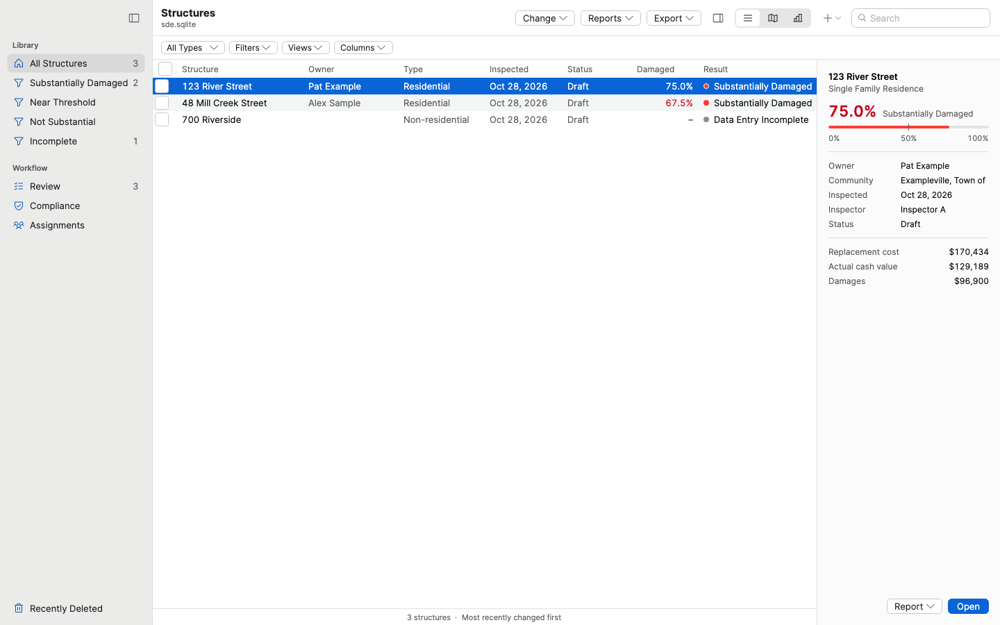

### Saving
Everything saves itself as you type. There is no Save button to forget. **File > Save** (⌘S) saves immediately if
you want to be sure before closing the lid.

### Where your data is kept
- The database is a single file. Until you make your own, SDE uses `~/Library/Application Support/SDE/sde.sqlite`.
- Photos are kept in an `attachments` folder next to the database file.
- Automatic backups are kept in a `Backups` folder next to the database file.

**Settings > Backups** shows the database file and the photos folder, with **Show in Finder**. **File > Show Database
in Finder** does the same from anywhere.

---

## 2. Setting up for an event
Do this once at the start of each event. It takes about ten minutes and saves a lot of typing later.

### 2.1 Make a database for the event
1. Choose **File > New Database…** (or **Database…** in the toolbar's **New** pull-down, or **New Empty Database…** in
   **Settings > Backups**).
2. In the save panel, make a new folder named for the event (for example `2026-09 River flood`) and save the database
   inside it. Its photos and backups will go into the same folder, so the whole event stays together.
3. SDE switches to the new, empty database. To go back to another one, use **File > Open Recent** or **File > Open
   Database…** (⌘O).

### 2.2 Tell SDE who you are
1. Choose **SDE > Settings…** (⌘,) and click **General** on the left.
2. Check **Your name**. It starts as your Mac account's name and is shown in each assessment's
   history next to the changes you make.

### 2.3 Fill in default values
Default values are filled into every new structure and assessment, so you type what is the same for every building
in this event only once (FEMA calls this *Enter Default Data*).

1. In **Settings > Defaults**, fill in what is the same for most buildings: for example the community, the
   FIRM panel information, the cause and date of the damage, and the cost data. They save as you type.
2. Turn on **Fill new structures with my default values** at the top of the same page.

### 2.4 Optional preferences
These are in **Settings > General**.

- **Check coordinates are in the structure's state**: FEMA's *Lat/Long Validation*. Turn it on to catch coordinates
  typed with a wrong sign or swapped.
- **Your fields**: three extra fields on every assessment. Name them for what your office tracks, such as *Permit
  number* or *Inspection team*.
- **Note snippets**: text you type often (for example a standard note about water lines). Click **Add Snippet**,
  give it a name and the text. In an assessment, **Insert Snippet** above any notes box adds it.

### 2.5 Things to set up only if you need them
| If you will… | Set it up in | Guide |
|---|---|---|
| Send letters to owners | Settings > Reports & letters | [Chapter 11](#11-owner-letters) |
| Track substantial improvement permits | Settings > Reports & letters | [Chapter 12](#12-substantial-improvement) |
| Count damage from several events together | Settings > Reports & letters | [Chapter 14](#14-cumulative-damage) |
| Use your community's depth-damage table | Settings > Depth tables | [Step 6 in chapter 4](#step-6-damage-by-element) |
| Let inspectors use phones | Settings > Phone form | [Chapter 15](#15-the-phone-form) |
| Let an AI assistant such as Claude work with the database | Settings > AI assistants | [Chapter 16](#16-ai-assistants) |

**Sharing the setup with colleagues:** see [Share your setup](#share-your-setup) in chapter 17.

### 2.6 Events
When one database holds more than one disaster, give each an event, so you can see one at a time.

1. Choose **Event > New Event…** (or **Event…** in the toolbar's **New** pull-down). Give it a name, the kind, FEMA's
   disaster number if there is one, and its dates. The **datum offset** is only needed when high-water marks use a
   different vertical datum from the structures' elevations: it is added to the marks.
2. The event appears under **Events** in the sidebar, and SDE chooses it. While it is chosen, **Structures**, the
   **Map**, the **Summary** and the reports, letters and exports you make from them cover only its assessments, and a
   new assessment you start joins it. Its name shows under the page title. Click another event to choose it, or
   **All Structures** to see every event again.
3. To put existing assessments in it, click **All Structures**, tick them on the Structures list, then **Change ▾ >
   Set Event…**. In the editor, **⋯ > Set Event…** does the same for one assessment.
4. When an assessment's damage date falls between an event's dates and it is in no event, the editor offers to add it
   (**Add to Event**).

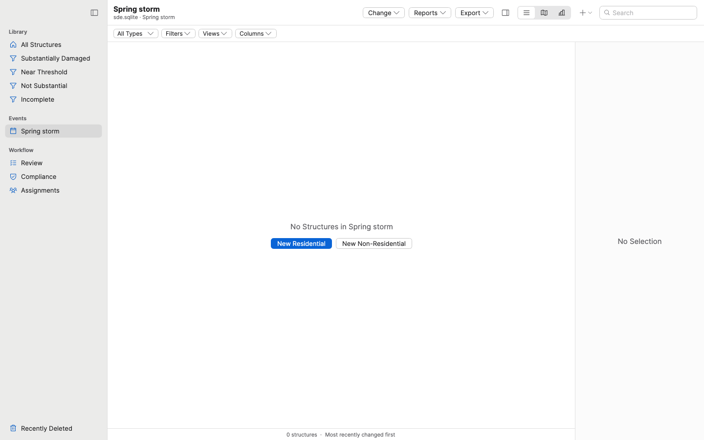

**Event > Manage Events…** renames or deletes events. Deleting an event keeps its assessments; they just belong to no
event. SDE remembers the chosen event for each database. Cumulative damage still counts every event together
(chapter 14).

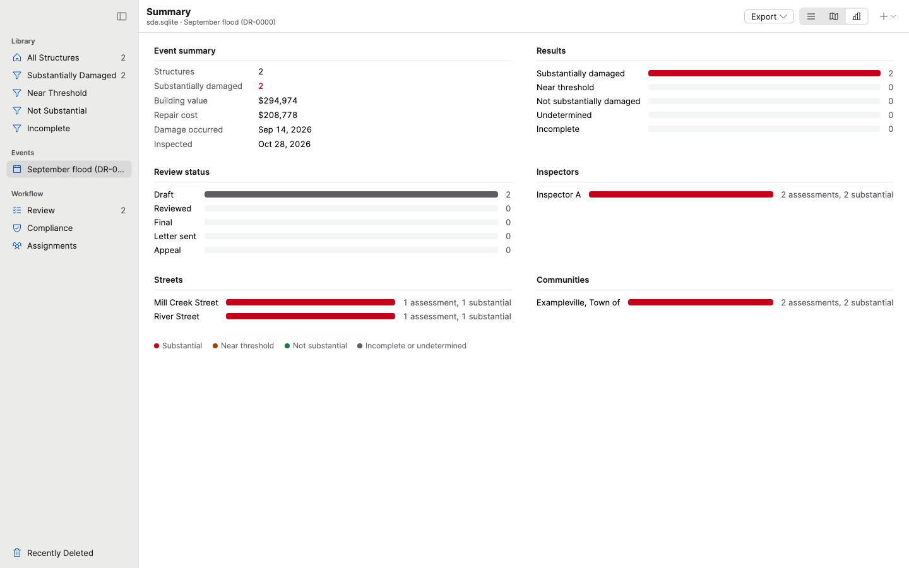

---

## 3. Adding structures
There are four ways to get structures into SDE. Use whichever matches where the information is now.

| The information is… | Use |
|---|---|
| Nowhere yet; you'll enter it as you inspect | [3.1 By hand](#31-by-hand) |
| In FEMA's SDE on Windows, or another copy of SDE for Mac | [3.2 From FEMA's SDE](#32-from-femas-sde-or-another-sde-for-mac) |
| In a permit or inspection system, a spreadsheet, or an assessor roll | [3.3 Inspections or parcels](#33-from-a-permit-system-spreadsheet-or-assessor-roll) |
| In a simple parcel spreadsheet, once | [3.4 Enterprise Import](#34-enterprise-import-femas-parcel-spreadsheet-import) |

### 3.1 By hand
1. Click **New** (+) in the toolbar and choose **Residential Structure** (⌘N) or **Non-Residential Structure** (⇧⌘N).
   **File > New Residential Structure** and **File > New Non-Residential Structure** do the same.
2. The editor opens on the first step. Go on to [chapter 4](#4-assessing-a-structure-step-by-step).

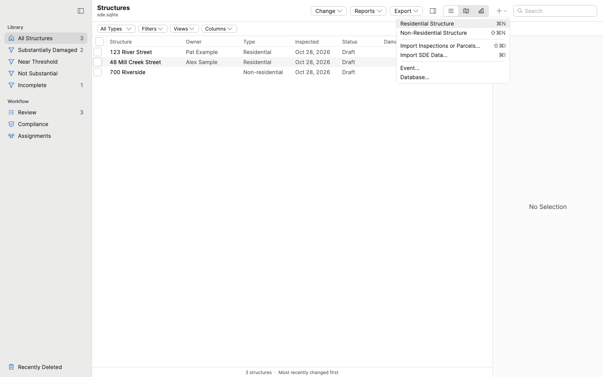

Nothing is saved until you type something, so opening a new structure and closing it straight away leaves nothing
behind.

### 3.2 From FEMA's SDE or another SDE for Mac
SDE reads three kinds of FEMA data: an **SDE export folder** (Export.json and photos, made by *Export SDE data* in
FEMA's SDE 3.0 or by SDE for Mac), a folder from the older **SDE 2.x**, and FEMA SDE 3.0's own database file,
**SDEDatabase.mdb**.

1. Get the data from the other computer: an export folder, or a copy of `SDEDatabase.mdb` together with the
   `attachments` folder beside it (that's where its photos are).
2. Choose **File > Import SDE Data…** (⌘I), or **Import SDE Data…** in the toolbar's **New** pull-down. Or open
   **Import & Export** (⌘8) and, under **FEMA SDE data > Import**, click **SDE Export Folder…** or **SDE Database
   (.mdb)…**. You can also drag the folder or `.mdb` file onto the Import & Export page.
3. Under **Ready to import**, SDE lists what it found before anything is added. Untick anything you don't want.
4. Choose what happens **If a structure is already in your database**:
   - **Keep mine (skip it)**,
   - **Replace mine with the imported one**, or
   - **Keep both (import a copy)**.
5. Click **Import Checked**.

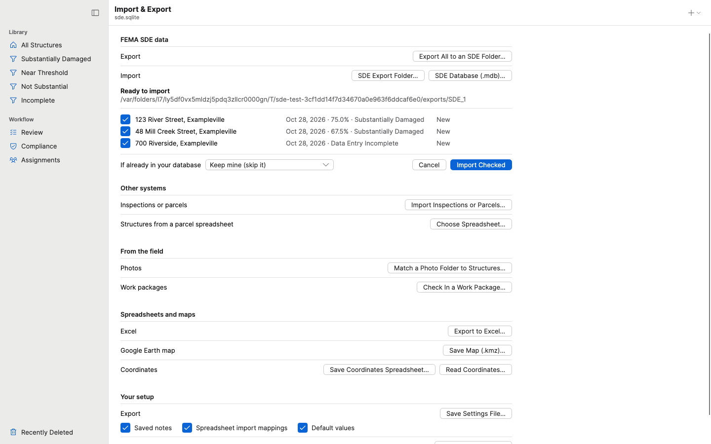

### 3.3 From a permit system, spreadsheet or assessor roll
This turns **inspections** into assessments, or a **parcel list or assessor roll** into structures. You can import an
updated file at any time: only what changed in it is updated, and edits you made in SDE are kept. The full details are
in [Importing inspections or parcels](IMPORTING.md); the steps are:

1. **Export from the other system.** Save its report or search results as `.xlsx`, `.xls`, `.csv` or a shapefile's
   `.dbf`. Include a **record ID** that never changes (a permit, inspection or parcel number).
2. Choose **File > Import Inspections or Parcels…** (⇧⌘I) or the same item in the toolbar's **New** pull-down, or
   **Import & Export > Inspections or parcels > Import Inspections or Parcels…**, and choose the file.
3. **Pick a profile.** A profile remembers how one source's files map to SDE. The first time, click **Start from an
   example** and pick the closest: **Generic inspections**, **County parcels** or **Accela (example)**. Next time, SDE
   picks your saved profile automatically.
4. **Say what the file is.**
   - **Source**: the system's name in your words, such as *Permits* or *County assessor*.
   - **Each record becomes** an assessment (inspections) or a structure (parcels).
   - **New records match** existing structures by record ID only, by parcel number, or by address.
5. **Map the columns.** For each SDE field, pick the column it comes from, or type one value for every record (for
   example the cause of damage). Each mapped field shows an example from the file.
6. **Translate the file's words.** Text that isn't one of FEMA's choices is listed with how many records use it. Pick
   what each means, for example *Slab on grade* is **Slab - on - Grade**.
7. **Confirm the building value** if SDE asks. FEMA's market value is the building only, never the land. If the column
   is a total of land and building, every percent damaged would come out too low.
8. **Check the preview** at the bottom: each record shows whether it is new, an update, unchanged, ambiguous or can't
   be imported, with its projected result. Untick any you don't want, then click **Import**.
9. Click **Review the N in Structures →** to see just what came in. The **Last import** chip above the list shows the
   filter; click its × to see everything again.

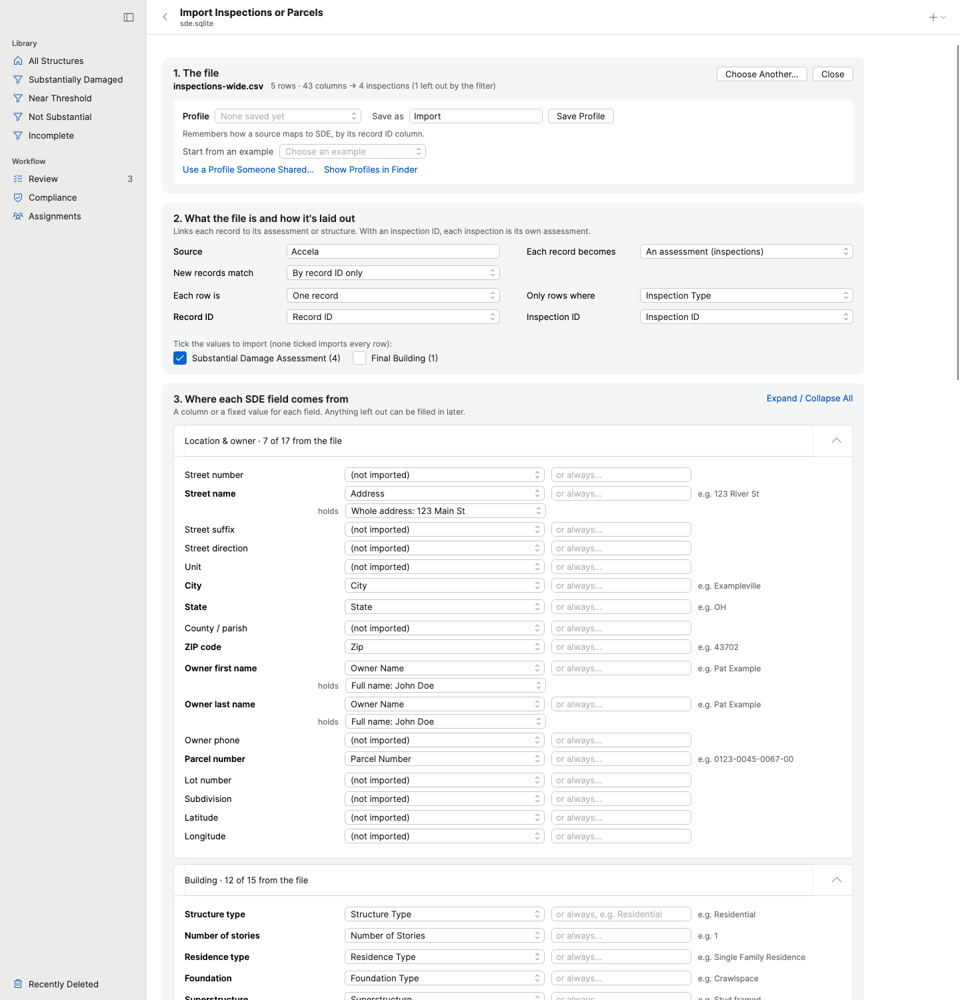

### 3.4 Enterprise Import (FEMA's parcel spreadsheet import)
FEMA's SDE has a simpler import that makes one structure per row of a parcel or GIS spreadsheet. SDE for Mac keeps it
for compatibility; for anything you will import again, use [3.3](#33-from-a-permit-system-spreadsheet-or-assessor-roll)
instead.

1. Open **Import & Export** and find **Structures from a parcel spreadsheet** under **Other systems**.
2. Click **Choose Spreadsheet…** and pick a `.xlsx` or `.csv` file. Choose the **Sheet** and whether the **First row
   has the column names**.
3. Match columns to fields, or pick a **Saved mapping**.
4. Click **Create Checked Structures**. SDE warns about rows that look like a structure already in the database (same
   parcel or address).

### 3.5 Adding coordinates
Structures need a latitude and longitude to appear on the map and in GIS files. Any of these work:

- [Look them up online](#8-looking-up-locations-and-flood-data-online) from the address.
- [Click each one on the map](#the-map) with **Set location**.
- Use a photo's GPS position ([chapter 5](#5-photos)).
- Add them in bulk with a spreadsheet:
  1. **Import & Export > Coordinates > Save Coordinates Spreadsheet…**
  2. Fill in the **Latitude** and **Longitude** columns, by hand or with a geocoder.
  3. Click **Read Coordinates…**. SDE shows each structure's coordinates **Now** and **From spreadsheet**.
  4. Untick anything wrong and click **Save Checked Coordinates**.

---

## 4. Assessing a structure, step by step

### Opening the editor
On **Structures**, double-click a row, or select it and press Return. The editor has three columns:

- **The steps** on the left. A count beside a step shows how many of its fields are left to check, in red when one is
  required.
- **The fields** of the current step in the middle.
- **The result** on the right: the **Percent Damaged** and FEMA's result, the bar with the 50 percent line, the values
  behind them, and **To Check**, which lists what is still missing.

The toolbar above holds the save state, the status pop-up (such as **Draft**, see [Statuses](#statuses)), **Previous
Step** and **Next Step**, the comments button, the **Assessments** and **Reports** pull-downs, and **⋯** (More), which
has the rest of the assessment's commands.

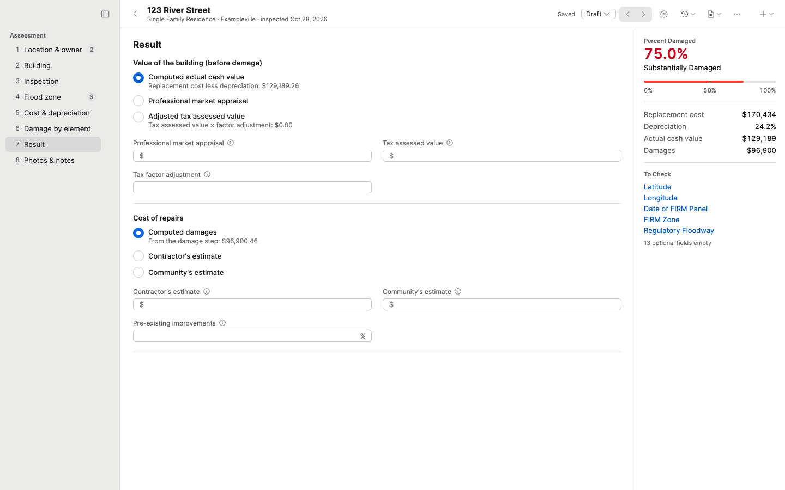

Move between steps by clicking them, with **Back** and **Next** under the fields, or with ⌘[ and ⌘]. Click the arrow
(‹) beside the address in the toolbar to go back to the list. The **?** next to a field explains what to enter and
which page of FEMA's SDE User Manual covers it.

When you change something that makes other fields irrelevant, SDE clears them, as FEMA's SDE does. For example,
changing the cause of damage away from flood clears the flood details.

### Step 1: Location & owner
The address, parcel number, owner, owner's phone numbers, the mailing address if it differs, and the latitude and
longitude. **Look up online…** fills in the coordinates from the address ([chapter 8](#8-looking-up-locations-and-flood-data-online)).

### Step 2: Building
- **Structure type** and **Number of stories**.
- For homes: **Residence type**, **Foundation**, **Superstructure**, **Roof covering**, **Exterior finish** and
  **Heating & cooling**.
- For other buildings: **Structure use**, **Sprinkler system** and **Conveyance (elevators)**.
- **Year built**, **Construction quality** and **Notes about the structure**.

### Step 3: Inspection
- **Inspector**, **Inspector phone** and **Inspection date**.
- **Date damage occurred** and **Cause of damage** (with **Describe the cause** for *Other*).
- For floods: **Flood duration** with its units, **Flood elevation** and **Depth above lowest floor**.
- **Damage undetermined**, with the **Reason damage is undetermined**, when the building couldn't be assessed.

### Step 4: Flood zone
**NFIP community ID**, **Community name**, **FIRM panel number**, **Panel suffix**, **FIRM panel date**, **FIRM zone**,
**Base flood elevation (BFE)**, **Regulatory floodway**, **Elevation of lowest floor** and **Datum**. **Look up
online…** proposes values from FEMA's National Flood Hazard Layer for you to confirm.
**Elevation certificate…** reads these values from a filled elevation certificate (see
[Elevation certificates](#elevation-certificates)).

### Step 5: Cost & depreciation
1. **Square footage.** Add the building's footprint as shapes (**+ Rectangle**, **+ L-shape**, **+ T-shape**,
   **+ U-shape**) with lengths, widths and stories, or **+ Type a total**.
2. **Base cost per sq ft**, **Geographic adjustment**, **Cost data source** and **Cost data date**.
3. **Cost adjustments**: features that add to the replacement cost. The list depends on the type of building.
4. **Additional adjustments**: anything else that belongs in the replacement cost, up to seven lines.
5. **Condition rating**, which sets the **Depreciation**. If you choose *Other*, say why.

The step shows the arithmetic: base cost × square footage × geographic adjustment, plus adjustments, gives the
**Replacement cost**; minus depreciation gives the **Actual cash value (pre-damage)**.

### Step 6: Damage by element
For each part of the building, estimate how much of it is damaged: 0 percent means untouched, 100 percent means it
must be fully replaced. FEMA's tables set how much of the replacement cost each part represents (**Share**), so the
step shows each element's cost and damage, and the total.

- On a slider, the keys **0** to **4** set 0, 25, 50, 75 and 100 percent.
- **Using a depth table** (if your community made one in **Settings > Depth tables**):
  1. If there is more than one, choose the table beside **Suggest from Depth Table**.
  2. Click **Suggest from Depth Table**. SDE fills in the values your table gives for the depth above the lowest floor,
     each marked **Suggested**.
  3. Look at each one, then click **Accept**, change it, or click **Accept All**.

  An assessment can't be made Final while any suggestion is still unaccepted, because a suggestion is not an
  inspector's judgment.

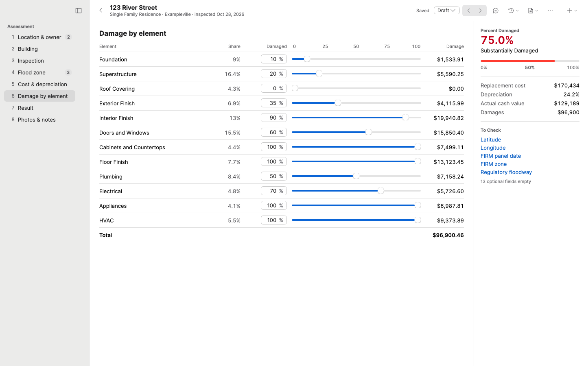

### Step 7: Result
Choose the two numbers the percent damaged is based on:

- **Value of the building (before damage)**: **Computed actual cash value** (from step 5), a **Professional market
  appraisal** (the structure only, from a licensed appraiser), or the **Adjusted tax assessed value** (the tax assessed
  value × the **Tax factor adjustment**, which turns assessed value into market value).
- **Cost of repairs**: **Computed damages** (from step 6), a **Contractor's estimate**, or the **Community's estimate**.

**Pre-existing improvements** is recorded for the report; FEMA's calculation doesn't use it.

### Step 8: Photos & notes
Photos ([chapter 5](#5-photos)), notes (with **Insert Snippet**), and **Your fields**.

### When is an assessment finished?
Look at **To Check** in the result panel. It lists required fields first, and beside the heading it says how many are
required (for example **2 required**). When no required count shows, everything FEMA's SDE requires has been entered;
**Nothing missing** means nothing required or recommended is left. Optional details (such as the owner's mailing
address) can be added later.

### More than one assessment of a structure
In the editor, the **Assessments** pull-down in the toolbar lists every assessment of the structure. **New Assessment
of This Structure** starts another one, for example for a re-inspection or a later event.

### Copying from a similar building
For rows of similar buildings, open the new assessment and choose **⋯ > Copy from Another Structure…**. Pick the
structure and tick the steps to copy. The location, owner and damage are never copied.

---

## 5. Photos

### Adding photos
1. Open the assessment and go to **Photos & notes**.
2. Drag photos onto **Drag photos here**, or click **Choose Photos…**. JPEG, PNG and HEIC (the iPhone's format) all
   work; HEIC photos are converted to JPEG.
3. If a photo has a GPS position or a date, SDE offers **Use as the Structure's Location** and **Use as the Inspection
   Date**. Click **Not Now** to skip.

### Order, report photo and descriptions
- Reports show the photos in their order, with the starred **Report photo** first. Drag a photo by its handle, or use
  the arrows, to change the order. **Use on reports** stars a photo.
- Type a **Description** under each photo; it appears on the reports.
- **Remove** moves a photo to Recently Deleted, so it can be restored for 30 days.

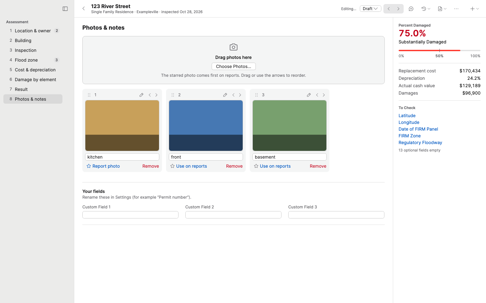

### Marking up a photo
Click the pencil at the top of a photo to draw on it: a **Water line** where the water reached (with an optional
label such as "Water 2 ft 6 in"), an **Arrow**, a **Box**, an **Ellipse** or **Text**.

1. Choose what to draw and a colour. A water line is blue and the others red unless you pick a colour.
2. Drag across the photo: along the water line, from an arrow's tail to its point, or from one corner of a box or
   ellipse to the other. For text, type the words first, then click where they go.
3. **Undo** takes back the last change and **Clear All** takes every mark off. Click **Save**.

The photo file itself never changes. The thumbnail, the printed reports and the submission folder's marked-up copies
draw the marks on, while FEMA's export keeps the original photo. The marks of a Final or Letter sent assessment can be
looked at but not changed.

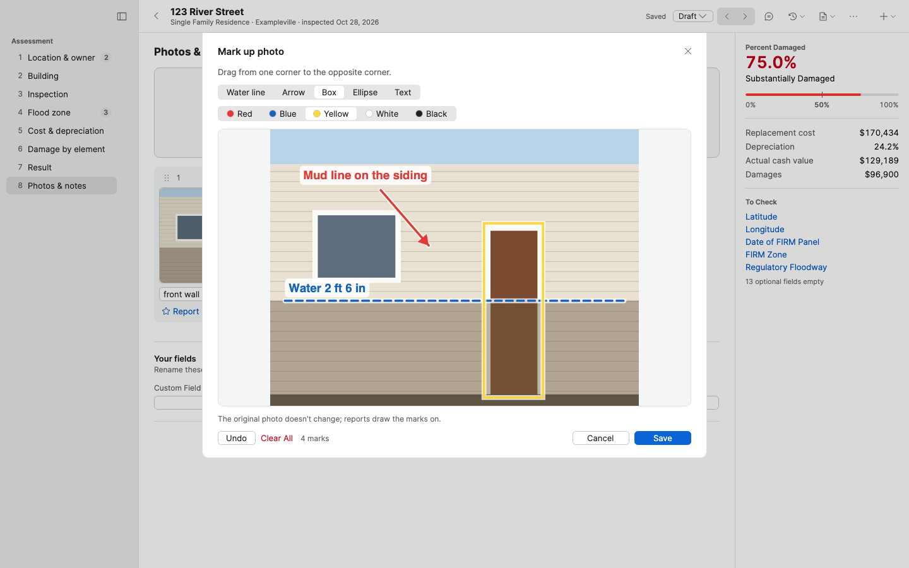

### Matching a whole folder of photos to structures
When field teams bring back a folder of photos:

1. Open **Import & Export > From the field > Photos** and click **Match a Photo Folder to Structures…**.
2. Choose the folder. SDE matches each photo by a record ID, parcel number or address in its file name, or otherwise
   by its GPS position (within 40 metres).
3. Check the list (**Photo**, **Structure**, **Why**, **Distance**). Photos that match no structure, or two structures
   equally, are left out.
4. Click **Attach Ticked Photos**.

---

## 6. Reviewing, locking and undoing

### Statuses
Every assessment has a review status, set with the status pop-up in the editor's toolbar (it shows the current one,
such as **Draft**):

| Status | Meaning |
|---|---|
| **Draft** | Being entered. Every new assessment starts here. |
| **Reviewed** | Someone has checked it. |
| **Final (Locks It)** | The determination is made. Nothing can change it. |
| **Letter Sent (Locks It)** | The owner has been told. Set by **Mark as Sent…** after writing letters. |
| **Appeal** | The owner has appealed and it is being reconsidered. |

The Structures list has a **Status** column and a status filter under **Filters**, so you can list everything not yet
Final.

### The Review page
**Review** (⌘4) is where a reviewer works through the assessments before they are made Final. It follows the event
chosen in the sidebar. The count beside it in the sidebar is the number of assessments in review (Draft or Reviewed).

- **Queue** lists the assessments in review, the ones with the most problems first. Each row shows the result, how
  many quality checks found something (**Checks**) and how many comment threads are open (**Comments**). Choose
  another status above the list, or **Every status**. Click a column's header to sort by it. Double-click a row to
  open the assessment; closing it brings you back to Review.
- **Quality checks** lists what the checks found, grouped by check, with what each check looks for. Errors, such as an
  inspection dated before the damage, should be fixed before you export. Warnings and notes are worth a look.
  - **Go to field** opens the assessment at the field to fix.
  - When something doesn't need fixing (two units on one parcel, say), click **Set Aside…** and say why.
  - Tick **Show the ones set aside** to see them with their reasons. **Bring Back** lists one again.
  - Setting aside and bringing back are kept in the history.
- Select an assessment in the queue to see its open checks and its **comments** beside the list. Write a comment for
  the inspector or other reviewers, **Reply** to one, and **Resolve** it when it is settled. In the editor, the
  comments button in the toolbar (or **⋯ > Comments…**) shows the same threads. A comment about a field links to it.
- **Mark reviewed** sets the ticked assessments (or the selected one) to Reviewed. Final and Letter sent assessments
  are left alone.
- The line of counts at the top shows how many are **In review**, the **Open checks**, the **Errors** and the **Open
  comments**. Click one to see them.

The flood map zone and high-water mark checks need an online look-up or a marks file, so the Review page doesn't run
them.

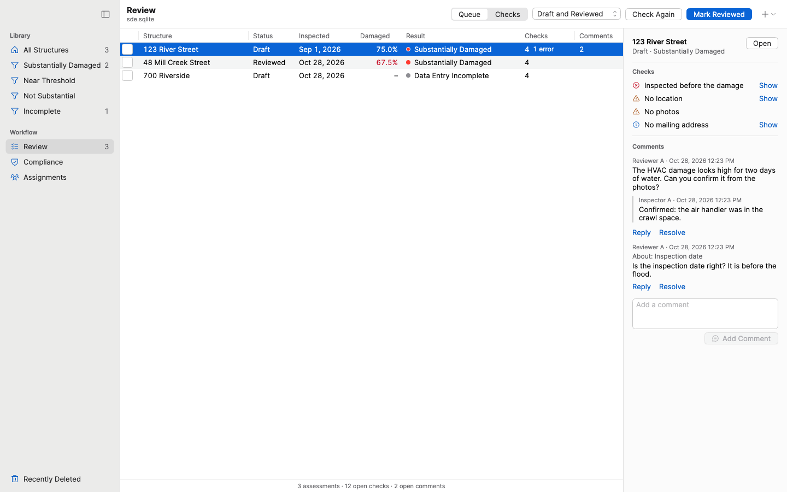

### Locks
A **Final** or **Letter sent** assessment can't be changed: not in the editor, not by bulk changes, not by imports and
not from the phone form. To change one, choose another status from the status pop-up. SDE asks for a reason, which is
kept in the history.

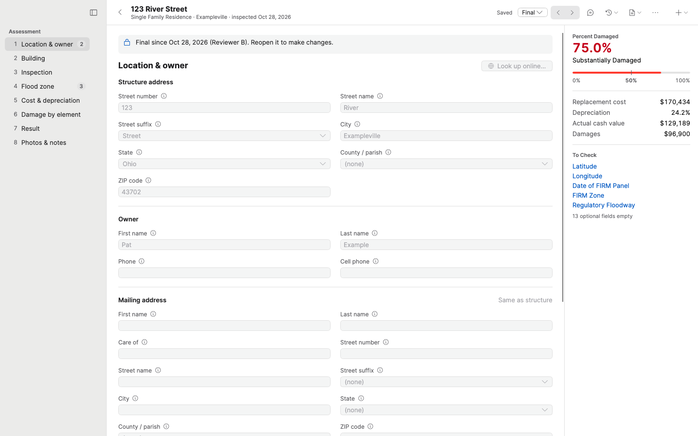

### History
**⋯ > History…** in the editor shows who changed what and when, including bulk changes, imports and changes made from
a phone. A change can be reversed from the history with **Undo this change**.

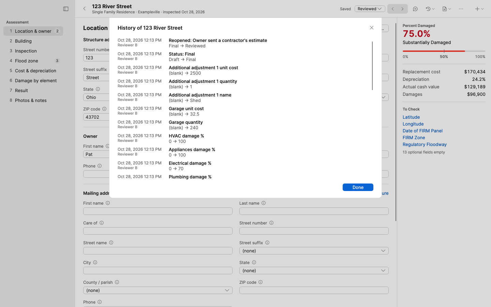

### Undo and redo
In the editor, **Edit > Undo** (⌘Z) and **Edit > Redo** (⇧⌘Z) step back and forward through your changes.

### Recently Deleted
- To delete a structure or assessment, use **⋯ > Move to Recently Deleted** in the editor, or right-click its row on
  Structures.
- Deleted items stay in **Recently Deleted** (at the bottom of the sidebar, ⌘7) for 30 days. Click **Restore** beside
  one to bring it back, or **Delete Now…** to remove it for good. **Empty Recently deleted…** removes everything there.

---

## 7. Working with many structures

### Finding structures
- **Search** (the field in the toolbar, ⌘F): type part of an address, owner, parcel number or record ID.
- **The groups under Library** in the sidebar (**Substantially Damaged**, **Near Threshold**, **Not Substantial** and
  **Incomplete**) show only the structures with that result.
- The pop-ups above the table:
  - **All Types**: residential, non-residential or both.
  - **All Sources / Imported / Entered in SDE**: shown once anything has been imported.
  - **Filters ▾**: **Inspected from** and **to**, **Damaged at least** and **at most** (percent), **Street**, **ZIP
    code**, **Parcel number** and **Status**. **Clear Filters** removes them. Filters are remembered.

The status bar under the table says how many structures are shown and how they are sorted, or how many are checked.

### Sorting, columns and saved views
- Click a column heading to sort by it. **The order you see is the order reports print in.**
- **Columns ▾** shows or hides columns such as ZIP, parcel, FIRM zone, source record and last changed.
- **Views ▾ > Save View…** saves the current search, filters, sort and columns under a name, for example
  *Not yet Final on Main Street*. Pick it from **Views ▾** later.

### Checking structures
Tick the box at the start of each row, or the box in the heading to check every structure shown. **Change ▾,
Reports ▾ and Export ▾ (at the right, above the table) work on the checked structures, or on every structure shown
when none is checked.**

### Setting one field on many structures
1. Check the structures (or filter the list to them).
2. Choose **Change ▾ > Set a Field…** (or **Edit > Set a Field on Checked Structures…**).
3. Pick the field and the value, check the preview and apply.

Final assessments are skipped. The whole change is one entry in each assessment's history, so it can be undone there.

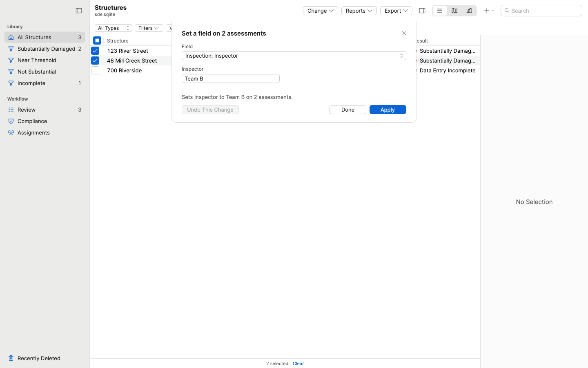

### Search and replace
**Change ▾ > Search and Replace…** (or **Edit > Search and Replace…**) replaces text in the same fields FEMA's SDE
allows, with a preview before anything changes.

### Right-clicking a row
**Open**, **Copy from Another Structure…**, **Set a Field on the Checked Structures…**, **Set Event for the Checked
Structures…** and **Move to Recently Deleted**.

### Field teams and routes
The **Assignments** page sends structures out to field teams, each with its structures in a driving order, a route
sheet and worksheets. With an event chosen in the sidebar, it shows that event's assignments.

1. Click **New Team…** in the toolbar and give the team a name, its members and a colour.
2. On Structures, check the structures (or filter the list) and choose **Change ▾ > Assign to Team…**, or select
   structures on the map and click **Assign to Team…**. Pick the team and, if you like, the event.
3. On **Assignments**, choose the team in the list at the left. **Order Route** puts its structures in a short
   driving order (straight-line distance); structures without coordinates go at the end. Double-click a structure to
   open its assessment.
4. **Route Sheet…** saves a one-page list of the stops, and **Worksheets…** a page per structure with a short code the
   phone form's search accepts and a small map around it (from the map's background, when it has one). The pin beside
   a structure opens directions in Maps. **⋯ > Keep Map Offline…** keeps the map of the team's area on this Mac for
   the field. **⋯ > Edit Team…** and **Remove Team…** change or remove the team (or right-click it in the list).
5. As the team works, set each structure's **Status**: Assigned, Visited, Done or Skipped. The team's line shows how
   many are assigned, assessed and done (so does the status bar), and the Summary has a **Field teams** chart with
   the same numbers.
6. To take structures off a team, check them and click **Remove from Team…** (in the toolbar, or right-click).

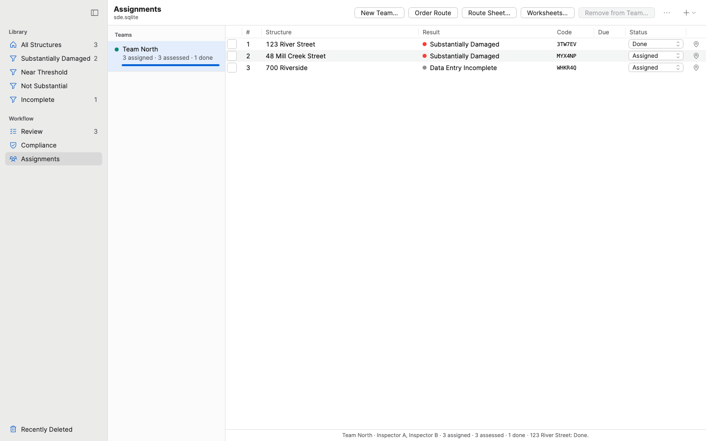

### Work packages: assessing on another Mac without a connection
A work package takes assessments to a Mac in the field and brings the work back.

**At the office**
1. On Structures, check the structures (or filter the list) and choose **Export ▾ > Work Package for the Field…**.
   Final and Letter sent assessments, and ones already out, are left out.
2. Type who takes it (**Checked out to**) and click **Save Work Package…**. SDE writes a `.sdework` file with the
   assessments, their structures, photos and documents.
3. Until the package comes back, those assessments are read-only here. The editor says where they are.

**In the field**
1. Choose **File > Open Work Package…** and choose the file. SDE opens the package as its own database, with a banner
   across the top.
2. Work as usual, without a connection.
3. When you're done, click **Send Back to the Office…** in the banner and save the file.

**Back at the office**
1. On **Import & Export**, under **From the field**, click **Check In a Work Package…** and choose the file. The field's
   work replaces the copies here, and History shows each change as the field made it.
2. An assessment someone changed here meanwhile, or took back early, isn't checked in; SDE lists it.

**Taking back early.** If the package won't come back, click **Take It Back…** in the editor (or **Take Back…** for a
whole package on Import & Export). The assessment can change here again, but the package can no longer bring it back.
If the package does come back later, use **⋯ > Copy from a Work Package…** in the editor to tick the field's values to
copy over.

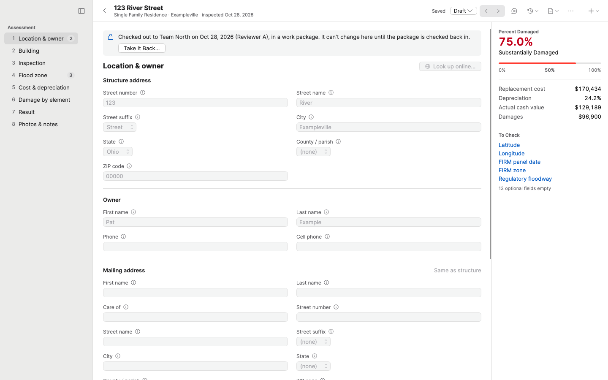

---

## 8. Looking up locations and flood data online
SDE can propose:

- **coordinates** from the address, using the U.S. Census Bureau's geocoder, and
- **flood data** from FEMA's National Flood Hazard Layer (NFHL): the flood zone, floodway, base flood elevation, FIRM
  panel, suffix and effective date, and the community ID.

This needs an internet connection. The address is sent to the Census Bureau and the coordinates to FEMA; nothing else
leaves your Mac. Nothing changes until you confirm it.

### For one structure
1. Open the assessment and go to **Location & owner** or **Flood zone**.
2. Click **Look up online…**.
3. SDE shows each **Field** with its value **Now**, the value **Found Online**, and where it came **From**.
4. Tick the values you want and click **Apply Ticked Values**. The history notes where they came from.

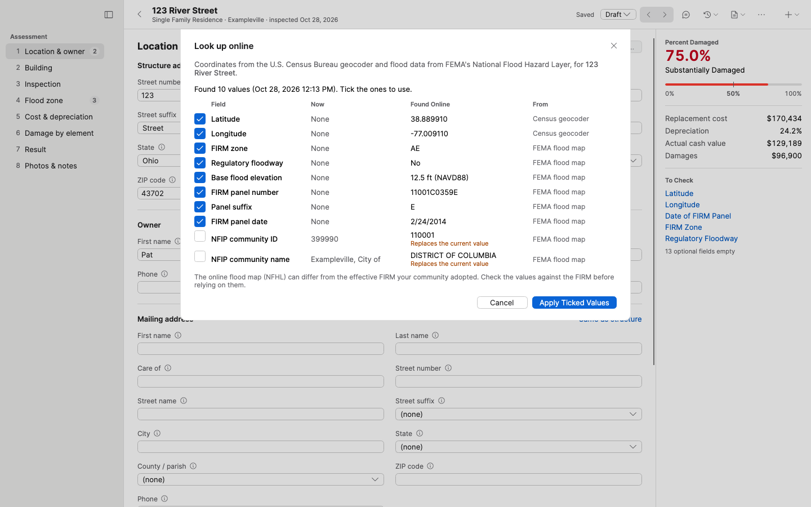

### For many structures
1. On Structures, check the structures (or filter the list).
2. Choose **Change ▾ > Look Up Flood Data Online…**. SDE looks them up a few at a time.
3. Review the results, tick the ones you want and click **Apply Ticked Values**.

**Check before you rely on it.** The NFHL is FEMA's online flood map. It can differ from the effective FIRM your
community has adopted (for example while a map revision is pending), so confirm against the effective FIRM.

### Elevation certificates
SDE reads FEMA's fillable elevation certificate (FEMA Form FF-206-FY-22-152) once a surveyor has filled it in.

1. Open the assessment, go to **Flood zone** and click **Elevation certificate…** (or choose **⋯ > Elevation
   Certificate…**).
2. Choose the PDF. SDE lists each **Field** with its value **Now** and the value on the **Certificate**: the location,
   community ID, FIRM panel and suffix, base flood elevation, first floor elevation and datum. Values that already
   match are left unticked.
3. If the address on the certificate doesn't match the structure, SDE says so. Check you chose the right certificate.
4. Tick the values to use and click **Save**, or click **Keep the PDF Only** to keep the certificate without changing
   any value.

When SDE can't read the PDF (a scan, or a copy that was printed to PDF), it shows an entry sheet instead: type the
values from the certificate and click **Save**. Either way the PDF is kept with the structure and the history lists
the changes as an EC import.

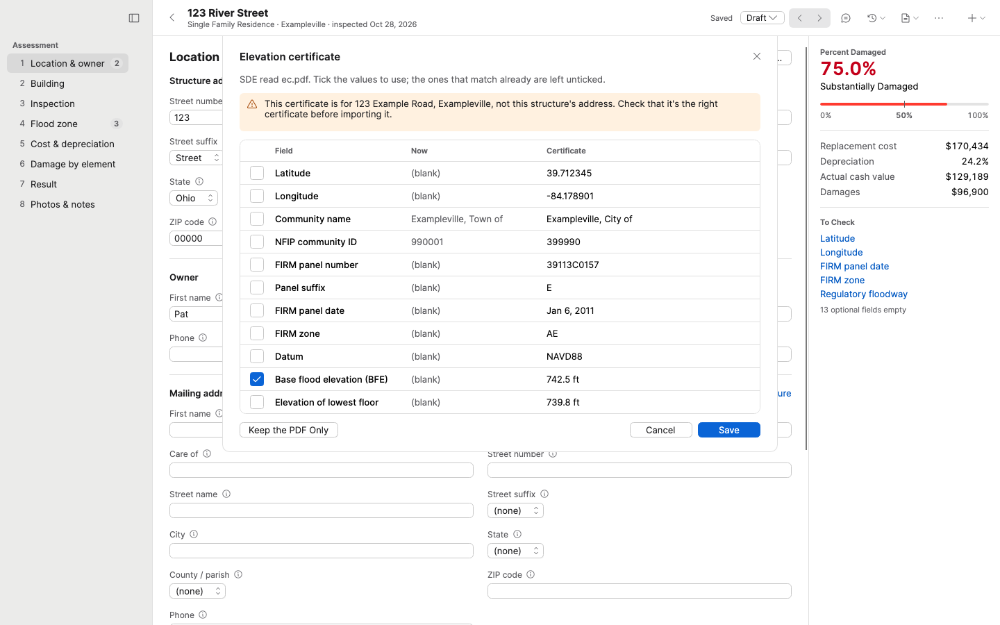

### Flood depth from high-water marks
SDE can estimate each structure's flood depth from where the water reached.

1. On Structures, check the structures (or filter the list), then choose **Change ▾ > Flood Depth from High-Water
   Marks…**. For one structure, use **⋯ > Flood Depth from High-Water Marks…** in the editor.
2. Choose where the water surface comes from:
   - **High-water marks file**: a CSV or GeoJSON file with each mark's latitude, longitude and elevation in feet
     (USGS exports read as they are). Say which datum the marks use when the file doesn't.
   - **USGS high-water marks**: click **Load USGS Events**, choose the event and the states, then **Download Marks**.
     This needs an internet connection; SDE asks USGS's Short-Term Network for the marks.
   - **Water-surface grid**: a GeoTIFF of water-surface elevations (not depths), in feet or metres.
3. **Options for marks** sets how far to look (**Search radius**), how many of the **Nearest marks** to use and the
   **Worst quality** of mark to trust.
4. SDE proposes the flood elevation and the depth above the lowest floor for each structure, with a **Confidence** and
   **How** it got there. Structures with no lowest floor elevation, or too far from any mark, say why.
5. Tick the depths to use and click **Save the Ticked Depths**. The history lists them as the depth tool's.

When an event's marks use a different datum from your elevation certificates, set the event's **datum offset** (see
[Events](#26-events)).

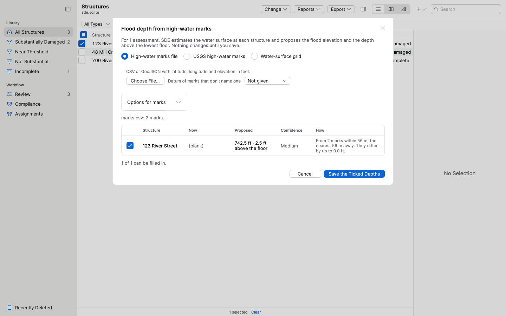

---

## 9. The map and the summary

### The map
**Map** (⌘2, or **Map** in the toolbar's switch) shows every structure that has coordinates, coloured by its result,
over a background map and any layers you add.

What a click does depends on the mode above the map:
- **Open**: click a dot to open that structure's assessment, or click a layer's shape to see its values. Hold ⌘ and
  drag to select structures.
- **Select**: click a dot or drag a box to select structures (hold ⌘ to add to the selection). **Select in** picks a
  layer to select its shapes instead. **Draw an area** selects what is inside the corners you click (double-click or
  press Return to finish). **By Attribute…** selects by the values of fields, for example *flood_zone = AE* and
  *land_value > 30000*.
- **Set location**: pick the structure under **Structure to Place**, then click where it is on the map.
- **Measure**: click points to measure a distance, or choose **Area** for an area and its perimeter. Double-click or
  press Return to finish. Distances are measured along the earth's surface, areas on an equal-area projection.

Selected structures are the ones checked in the Structures list. The bar on the map acts on them: **Show in
Structures**, **Set a Field…**, **Assign to Team…**, **Reports** and **Add to Web Map…**.

When the map has focus, the arrow keys move it and = and - zoom. **Bookmarks** saves the view and goes back to it.
**Show All** zooms to every structure. The basemap menu next to **Bookmarks** picks the background map: USGS
topographic map, USGS aerial imagery, OpenStreetMap or none.

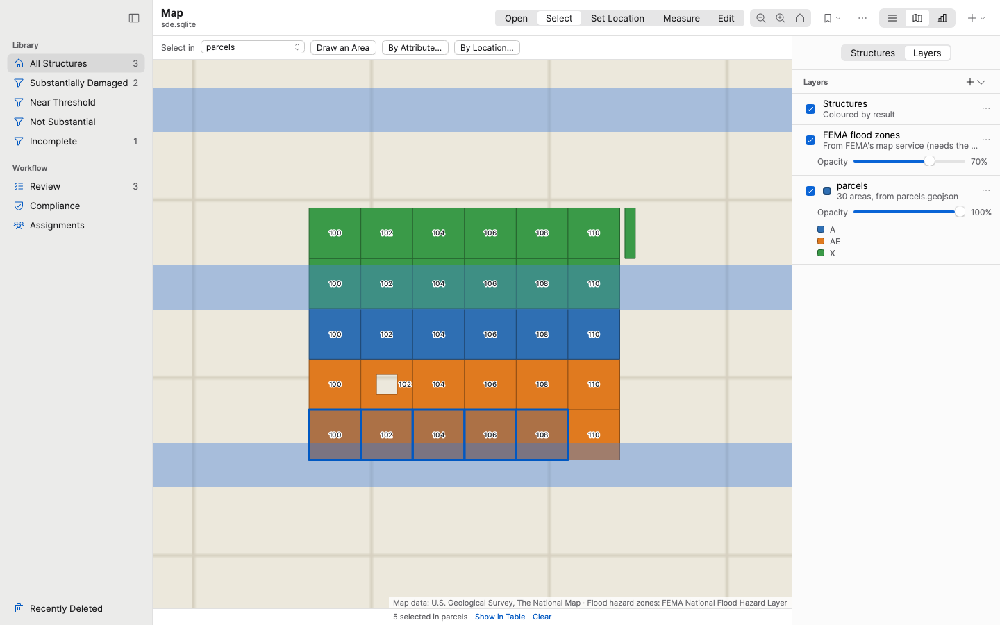

#### Layers
Click **Layers** beside the map:
- **Add Layer > From a File…** reads a Shapefile, GeoJSON, GeoPackage, or CSV with latitude and longitude (or WKT).
  SDE copies the shapes into a GeoPackage next to the database (`sde.sqlite.layers.gpkg`), which QGIS and ArcGIS
  open too.
- **Add Layer > From an ArcGIS Web Address…** downloads a FeatureServer or MapServer layer for the area in view.
- **Add Layer > FEMA Flood Zones** draws FEMA's National Flood Hazard Layer over the map.
- Each layer's **⋯** menu has **Style…** (one colour, by category or by number range, labels, and the scales it shows
  at), **Attribute Table**, **Zoom to Layer**, **Move Up**, **Move Down** and **Remove…**. **Opacity** fades it.
- **Style…** under **Structures** colours the dots by result (the default), status, team, event or any field.

The attribute table under the map sorts by a column, filters by text and can show only the selected shapes. Picking
rows selects them on the map.

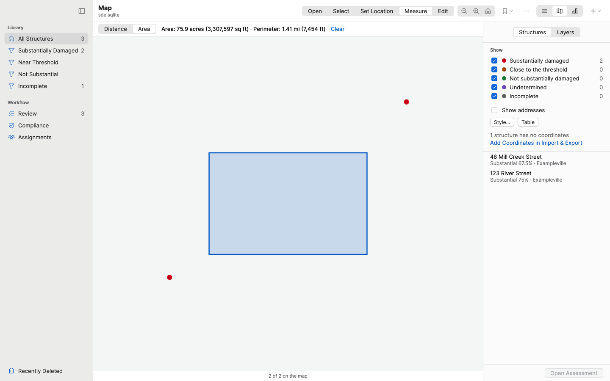

The background map, the flood zones and ArcGIS layers need an internet connection. The dots and layers from files work
offline.

#### Drawing and changing shapes
Choose **Edit** above the map to draw on a layer or change its shapes. Layers from files and layers you make in SDE can
be edited; ArcGIS layers and FEMA's flood zones can't.

1. Pick the layer next to **Edit**. To start a layer of your own, click **New Layer…**, give it a name and choose
   whether it holds **Points**, **Lines** or **Areas**. Each shape has a name and notes.
2. Choose a tool:
   - **Change**: click a shape to pick it. Drag a corner to move it, or drag the small dot between two corners to add
     one. Option-click a corner to take it away. Drag inside the shape to move all of it. Delete removes the picked
     corner, or the whole shape. Esc lets go of it.
   - **Add points**, **Add lines** or **Add areas**: click the corners, then double-click or press Return to finish.
     Delete takes away the last corner while you draw.
3. With **Snap** ticked, new corners and moved corners land exactly on nearby corners, edges and structures.
4. ⌘Z and ⇧⌘Z (or the arrows in the Edit bar) undo and redo each change.
5. Click **Save** to keep the edits in the map layers file next to the database. **Discard…** throws them away.

Nothing is written until you click **Save**. If you leave the Map page, choose another layer or quit with edits not
saved, SDE asks whether to save them. Opening another database saves them first.

While a layer is being edited, its attribute table can be typed in. A value that doesn't fit the field, such as
letters in a number field, isn't taken, and SDE says why.

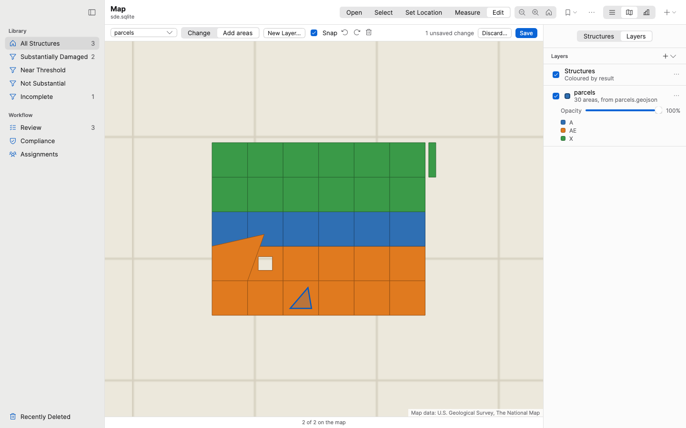

#### Moving a structure
If a dot is in the wrong place, choose **Set location** and drag the dot to where the structure really is. SDE asks
before saving, for example *Move 123 River Street about 40 ft north-east?*, and shows the old and new latitude and
longitude. **Move** saves the new coordinates, and the change is listed in the assessment's history.

A structure whose assessment is Final or Letter sent, or checked out in a work package, can't be moved or given a
location. SDE says which, and why.

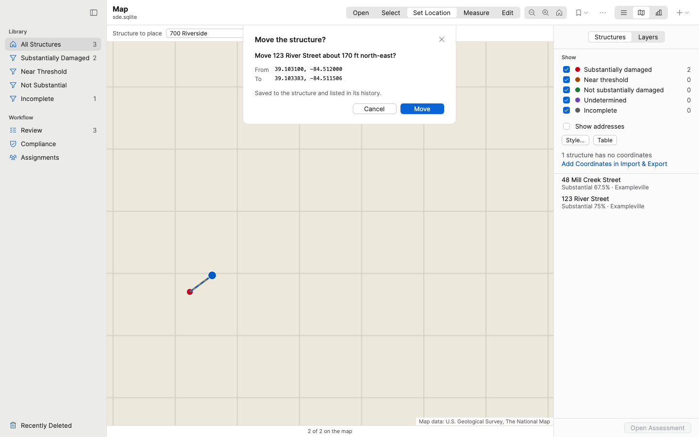

#### Selecting by location
In **Select** mode, **By Location…** selects what lies in, near or around other shapes:
1. **Select**: the structures, or the shapes of a layer.
2. **That**: *touch or overlap*, *are completely inside*, *completely contain*, or *are within a distance of* (in feet,
   miles or metres).
3. **Of**: the selected shapes of another layer, or an area you draw on the map.
4. **Selection**: **New selection**, **Add to it** (keep what is selected and add these), or **Select within it** (keep
   only the selected ones that also match).

The sheet counts what matches as you change it. Click **Select**. For a drawn area, click its corners on the map and
double-click or press Return to finish.

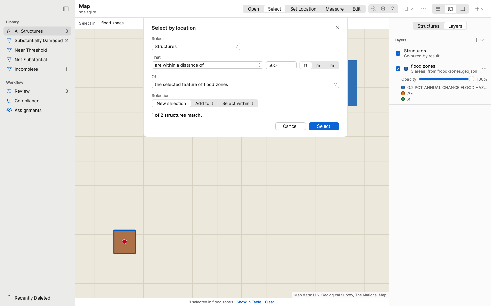

#### Copying values onto structures
A layer of areas, such as parcels or flood zones, can fill in a field of the structures that sit inside each area.
Choose **Copy Values Onto Structures…** from the layer's **⋯** menu, or select structures and click **Copy Values…** in
the bar on the map.

1. Choose **From the areas of** (the layer), **Their field**, and **Into the structure field**. SDE suggests the
   structure field from the layer's field name: a FEMA *FLD_ZONE* goes into the FIRM zone, a parcel number into Parcel
   number, an NFIP community ID or name into the community fields.
2. Choose the selected structures, or all the structures in the event.
3. Check the preview. Each structure shows its value **Now**, the **New** value, and **How It Was Matched**: inside one
   area, inside several (the smallest is used), or inside none. Untick any you don't want changed.
4. Click **Copy** (the button counts the values, for example **Copy 12 values**).

Each value goes in through the same checks as typing it in the editor. FIRM zones are matched to the choices on FEMA's
form, and a zone the form has no choice for is listed and left alone. The copy is one change in each structure's
history: **Undo** in the message that follows, or **Revert** in History, puts the old values back. Final, Letter sent
and checked-out assessments are left as they are and counted.

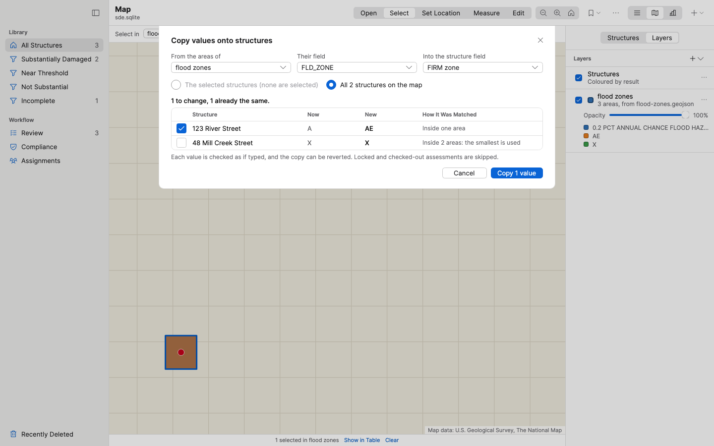

#### Printing the map
**Print…** at the top of the Map page makes a Letter-size PDF of the area the map shows now.

1. Type a **Title** (it starts as the event's name, or *Structures*) and choose **Portrait** or **Landscape**.
2. Click **Save as PDF…** and choose where to save it. SDE opens the PDF when it is done.

The page has the map, a legend of the structures and every layer shown, a scale bar, a north arrow, the scale (for
example *1:4,800 (1 inch = 400 feet)*), the sources the map uses, and the date. The map is drawn sharper than on
screen, so SDE downloads the background at more detail. It waits up to 30 seconds for those pieces. Any that don't
arrive are left blank, and the page says how many.

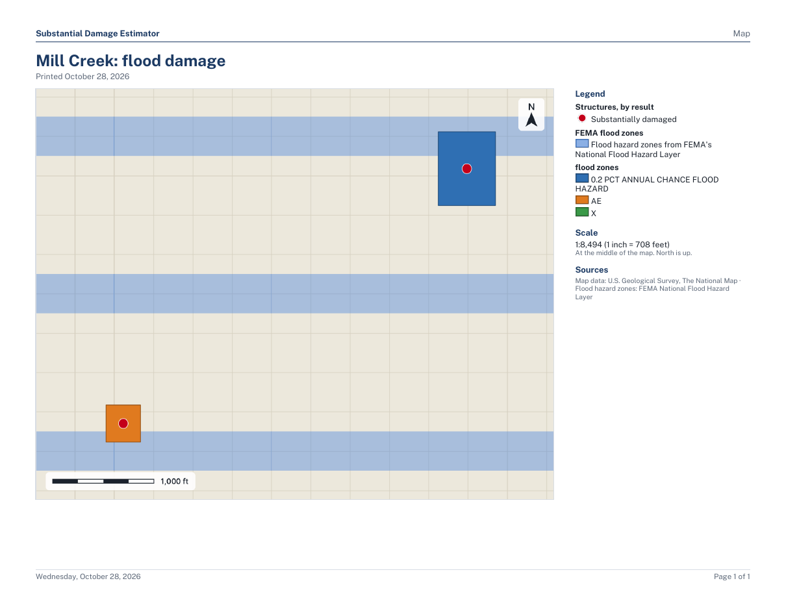

#### Keeping an area for use offline
Before going somewhere without a connection, keep the background map for the area on the Mac you take:

1. Show the area on the map and click **Offline…** (or, on **Assignments**, choose a team and choose **⋯ > Keep Map
   Offline…** for its structures and about 400 m around them).
2. Choose **USGS topographic map** or **USGS aerial imagery**. Only USGS maps can be kept: OpenStreetMap's rules don't
   allow downloading areas.
3. SDE says how many map pieces that is for zooms 12 to 16 (at most 5,000; for a large area the closest zooms are left
   out). Click **Keep Offline**.

The map then shows the area with no connection. Kept pieces are used until SDE can fetch fresh ones.

#### Map and GIS settings
**Settings > Map & GIS** has:
- **Background map**: the same choice as the basemap menu on the Map page.
- **Start the map with FEMA flood zones on**: each time this database's map opens, the flood zones show.
- **Saved map pieces**: how much room the background map pieces kept on this Mac take. **Clear** deletes them; the
  map downloads them again as it needs them.
- **Leave owner names out of GIS files**: on by default. Turn it off to have **Include Owner Names** in the summary's
  **Export** menu start on.

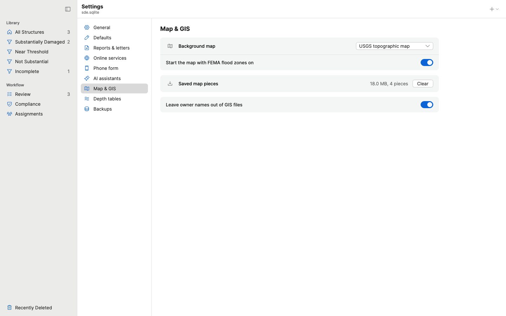

### The summary
**Summary** (⌘3, **Summary** in the toolbar's switch, or **Event > Event Summary**) shows the numbers for the
database, or for the event chosen in the sidebar: how many structures, how many substantially damaged, the total
building value and repair cost, and bars by result, by street (top ten), by community and by inspector.

The **Export** menu in the toolbar has:
- **Event Summary PDF…**: the same numbers as a report. With no event chosen, type an **Event name** under **Event
  summary** to show on it.
- **GeoPackage…** and **GeoJSON…**: one point per assessed structure, in latitude and longitude (WGS 84), with a QGIS
  style beside it. Owner names are left out unless you turn on **Include Owner Names** in the same menu (Settings >
  Map & GIS can have it start on).

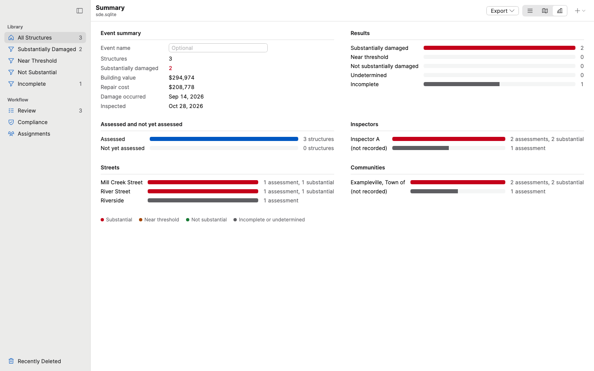

### Sharing a web map
A web map is a folder with a web page of structures on a map. Open it in any browser, send the folder, or put it on
any web server. The page works offline; only the background map needs the internet.

1. On Structures, check the structures (or filter the list), then choose **Export ▾ > Web Map…**. On the map, select
   structures and click **Add to Web Map…**. With an event chosen in the sidebar, the title is the event's name.
2. Choose **Who it is for**:
   - **Office and partners**: a dot for each structure with its address, result and percent damaged. Tick the
     other fields to show in each structure's popup, such as the inspection date or the depth above the lowest floor.
   - **Public**: structures are counted in **Grid squares** (100, 200 or 500 metres) instead of dots, owners are
     never shown, and **Addresses** are hidden or cut to the block ("100 block of River St").
3. Choose the **Background map** (USGS topographic, OpenStreetMap or None) and whether to show the event's summary
   beside the map.
4. Click **Make Web Map…** and choose where to put the folder. SDE opens the page when it is done. Structures without
   coordinates are left out and counted.

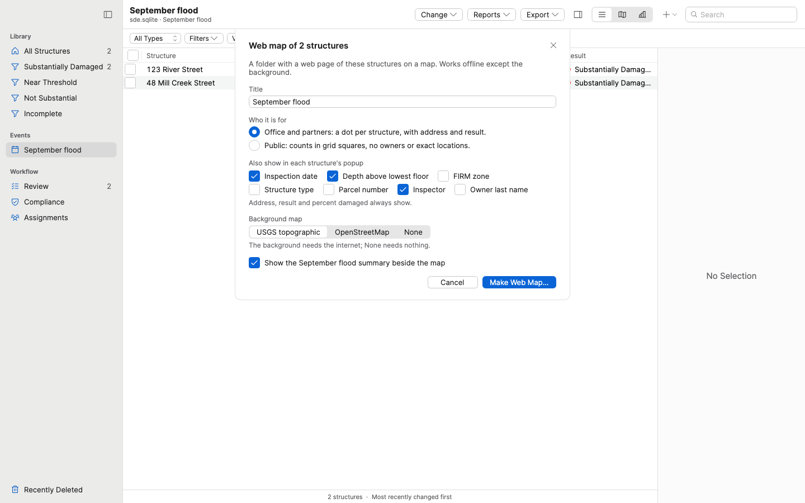

---

## 10. Reports and sending results to FEMA or your state

### Reports for one assessment
In the editor, the **Reports** pull-down in the toolbar prints a **Summary Report** (one page) or a **Detailed
Report**, each with or without photos, as a PDF.

### Reports for many
On Structures, **Reports ▾** prints the same reports for the checked structures (or all shown), plus the **Percent
Damaged List** and the **Community Report**. They print in the list's order.

### Exporting for FEMA's SDE or your state
1. On Structures, check the structures (or filter the list), then choose **Export ▾ > FEMA SDE Export Folder…**.
   To export everything, choose **File > Export All to SDE…** (⌘E) instead.
2. If some assessments aren't Final, SDE asks whether to export them anyway. If some have quality errors (see
   [The Review page](#the-review-page)), it says how many and offers to show them on the Review page instead.
3. Choose where to save. SDE writes an `SDE_n` folder with `Export.json` and the photos, exactly as FEMA's SDE writes
   it. FEMA's SDE 3.0 opens it with *Import SDE data*.

What SDE for Mac adds (statuses, history, import links, letters and so on) stays on your Mac and is never put in the
FEMA package.

### The submission folder
One folder with everything a community usually sends after an event:

1. On Structures, check the structures (or filter the list, or use the **Last import** chip).
2. Choose **Export ▾ > Submission Folder…**.
3. Choose the **Report for each** assessment (**Summary (one page)** or **Detailed report**), **With photos** or not,
   and whether to **Include incomplete assessments**.
4. Click **Write to a Folder…**. As with an export, SDE asks first about assessments that aren't Final or have quality
   errors. A progress bar shows each report; stopping removes the half-written folder.

```
SDE submission 2026-10-08 1430/
  Reports/                       one PDF per assessment
  Percent damaged list.pdf
  Community report.pdf
  SDE_1/                         the FEMA package: Export.json and photos
  results.csv                    one row per assessment, to enter results back into your permit system
```

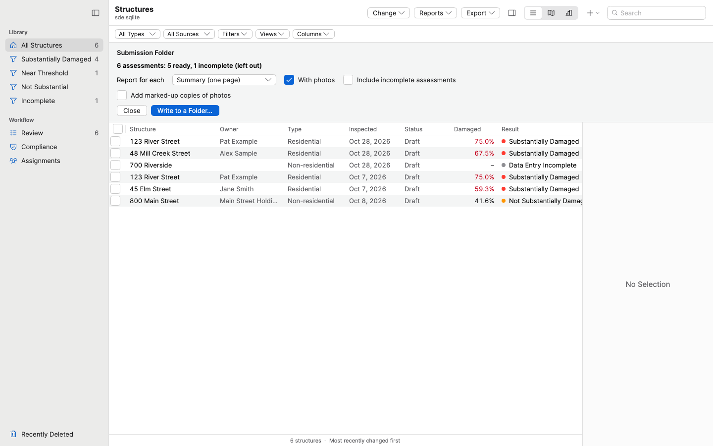

### Other exports
- **Excel**: **Export ▾ > Excel…** on Structures, or **Import & Export > Excel > Export to Excel…**: every assessment
  as one row, with the same 218 columns as FEMA's *Export to Excel*.
- **Google Earth**: **Import & Export > Google Earth map > Save Map (.kmz)…**: a pin for each assessment, coloured by
  percent damaged.
- **GIS**: GeoPackage and GeoJSON from the [summary](#the-summary).

---

## 11. Owner letters
SDE writes a letter to each owner from Word (`.docx`) templates you control. **Review the templates with your
community's counsel before you send any letters**; the starter text is a plain-English starting point, not legal
advice. Every placeholder is listed in [Owner letters](LETTERS.md).

### Set up the templates (once)
1. Open **Settings > Reports & letters** and, under **Owner letters**, click **Create Starter Templates**. You get
   three: *Substantial damage notice*, *Not substantially damaged notice* and *Substantial improvement determination*.
2. Click **Show Folder** and edit them in Word or Pages (save as `.docx`): your letterhead, your ordinance's
   requirements, how to appeal and by when.
3. A placeholder is a field name between guillemets, such as «OwnerName». Type « with ⌥\ and » with ⌥⇧\.

### Write a batch of letters
1. On Structures, check the structures (or filter the list, for example to *Substantially Damaged* and *Final*).
2. Choose **Export ▾ > Owner Letters…**.
3. **Choose a template**.
4. Fill in **From**: community, office, office address, phone, email, who signs and their title. These are remembered
   for this database.
5. Click **Choose a Folder and Write…**. SDE writes a folder named *Letters* with the date and time, holding one
   `.docx` per structure.
6. Print and send them. Then click **Mark as Sent…**: the assessments become **Letter sent**, which locks them, and
   the sending is recorded. (For one assessment: **⋯ > Mark Letter as Sent…** in the editor.)

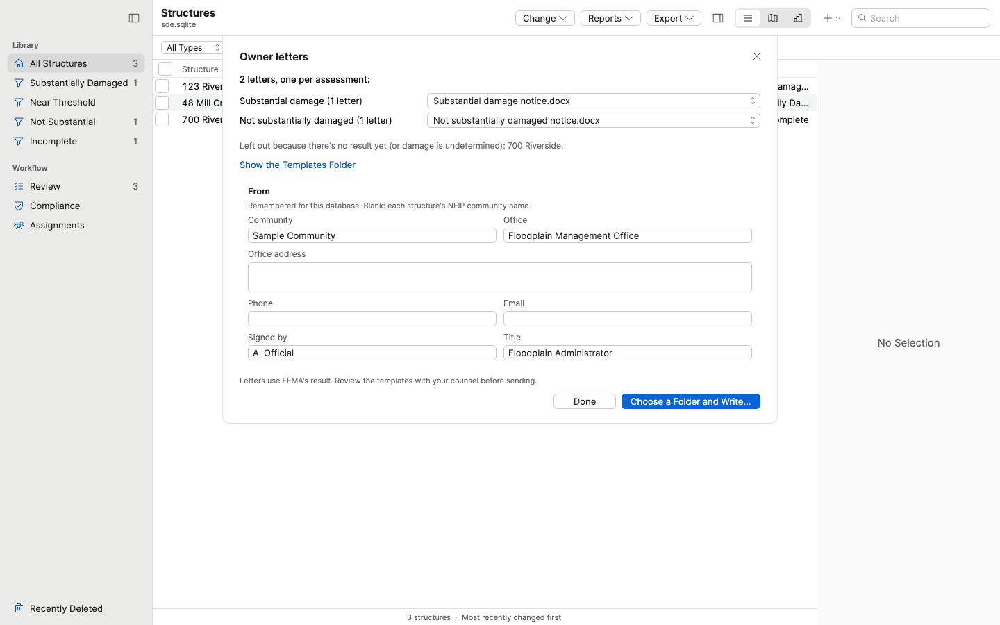

### Compliance and ICC (the Compliance page)
A substantially damaged (or substantially improved) building must be brought into compliance. **Compliance** (⌘5)
follows each one until it is: the way the owner chooses, the permit and deadline, the Increased Cost of Compliance
(ICC) claim, the elevation certificate and the final inspection. It follows the event chosen in the sidebar, and the
count beside it in the sidebar is the number of open cases past their deadline.

1. **Open a case.** On the Compliance page, **Open Missing Cases…** in the toolbar opens one for each substantially
   damaged structure that has none yet (the status bar says how many have none). For one assessment, use **⋯ > Compliance Case…** in the editor. For a substantial
   improvement, click **Open compliance case…** beside the determination in **⋯ > Improvements and SI…**.
2. **Fill it in.** Double-click a case (or select it and click **Open Case…**). Choose the **Path** (elevate, relocate, demolish, floodproof for
   non-residential buildings, or repair below the threshold after an appeal), then the permit, **Deadline**, ICC
   claim and its status and amount, and the dates the elevation certificate, final inspection and certificate of
   compliance came in. **Save** or **Done** keeps it.
3. **Keep the timeline.** Changes to the path, deadline, ICC status and open or closed are added to the case's
   timeline by themselves. Add calls, inspections and notes with **Add Note**.
4. **Write a letter.** Under **Letters**, choose **Options and Deadline…**, **ICC Support…** or **Deadline Reminder…**. The
   first time, SDE offers to create the three starter compliance letters in your templates folder. The letter is
   filled in from the case, opened in Word, and added to the timeline and the letter log. See
   [Owner letters](LETTERS.md) for the fields.
5. **Close it.** Set **Case** to **Closed** and say why (for example *Elevated and inspected*).

The pop-up in the toolbar shows **Open cases**, **Closed cases** or **Every case**. The filter button beside it
filters by path, by ICC status or to **Overdue Only**, names the filters that are on, and has **Clear Filters**. The
status bar under the list counts the cases shown, the overdue ones and the ICC claims in progress and paid. **Export ▾**
saves the cases shown as a **Compliance Report (PDF)…** or a **Compliance List (CSV)…**. The Summary shows the open
and overdue cases and the ICC claims too.

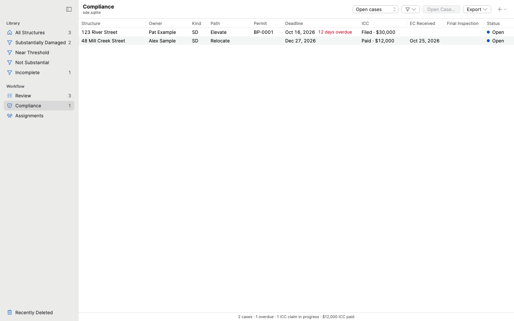

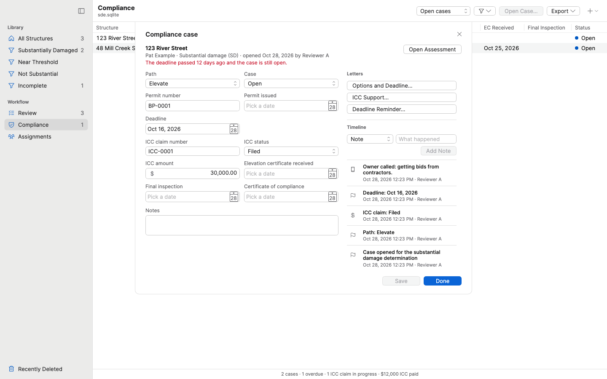

---

## 12. Substantial improvement
Substantial improvement (SI) tracking compares the cost of improvement projects with the structure's market value.
It is a separate finding: it never changes a damage assessment, its percent damaged or FEMA's result.

### Set the rules (once per database)
In **Settings > Reports & letters**, under **Substantial improvement**:
- **Threshold**: percent of market value (the NFIP minimum is 50 percent; your ordinance may be stricter).
- **Look-back period** in years. **0** counts each project on its own.
- Tick **Add earlier projects in the look-back period (cumulative)** if your ordinance counts improvements
  cumulatively.

### Make a determination
1. Open the structure's assessment and choose **⋯ > Improvements and SI…**.
2. Click **+ New Project** and fill in the **Permit number**, **Date (permit or start)**, **Description**, **Cost of
   the improvement** and **Where the cost came from**. Untick **Counts toward substantial improvement** for work that
   doesn't count (say why, for example routine maintenance). Click **Save Project**.
3. Check the **Market value of the structure**: the building only, not the land, before the improvement. It starts as
   the building value of the latest damage assessment. Say where it came from.
4. SDE shows the **Improvement Cost as a Percent of Market Value** and the determination. Add **Notes for the
   determination** and click **Save Determination**.
5. **SI Determination PDF…** prints it. To tell the owner, use the *Substantial improvement determination* letter
   ([chapter 11](#11-owner-letters)).

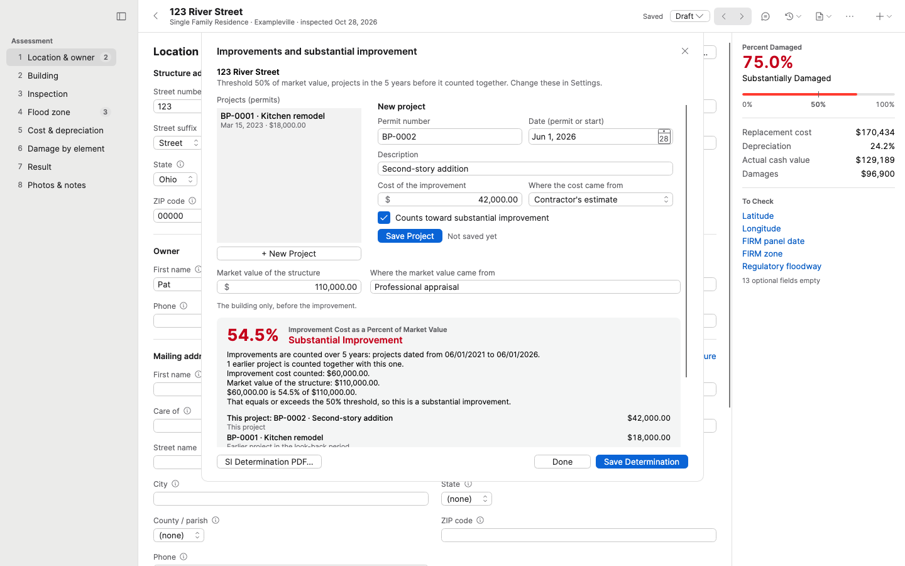

---

## 13. Appeals and contractor bids
When an owner disputes a determination, record the appeal and compare their contractors' bids with the computed
damage.

1. Open the assessment. Set its status to **Appeal** with the status pop-up while it is being reconsidered.
2. Choose **⋯ > Appeal…**.
3. Under **The appeal**, fill in the date it was **Received**, the **Basis** (what the owner disputes, and why) and any
   **Notes**. Click **Save Appeal**.
4. Under **Contractor bids**, enter each **Contractor**, **Amount** and **Date of the bid**, and click **Add Bid**. For
   each bid, SDE shows the percent damaged FEMA's engine gives with that bid as the repair cost (**With This Bid**).
   Nothing changes yet.
5. If you accept a bid, click **Use This Bid…** and confirm. The assessment's cost of repairs becomes that contractor's
   estimate and the result is recalculated.
6. Record the **Outcome**, click **Done**, and set the status back to **Final** when the appeal is decided.

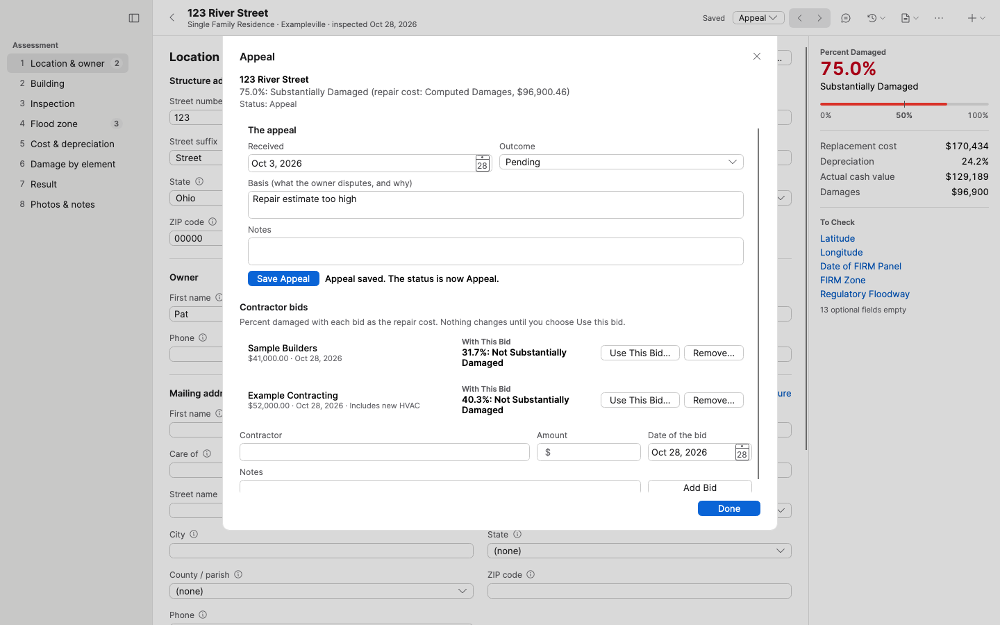

---

## 14. Cumulative damage
Some ordinances count damage from several events together. This is **off** unless you turn it on, and it is a
separate finding: each assessment keeps FEMA's own percent damaged and result, and FEMA's reports and exports don't
change.

1. Open **Settings > Reports & letters** and, under **Cumulative damage**, turn on **Count damage from several events
   together**.
2. Choose the **Method**, the **Look-back period** in years (**0** counts every event on record) and the
   **threshold** your ordinance uses.
3. An assessment's result panel now also shows the cumulative total over the look-back period. Each event is counted
   once, by the date the damage occurred.

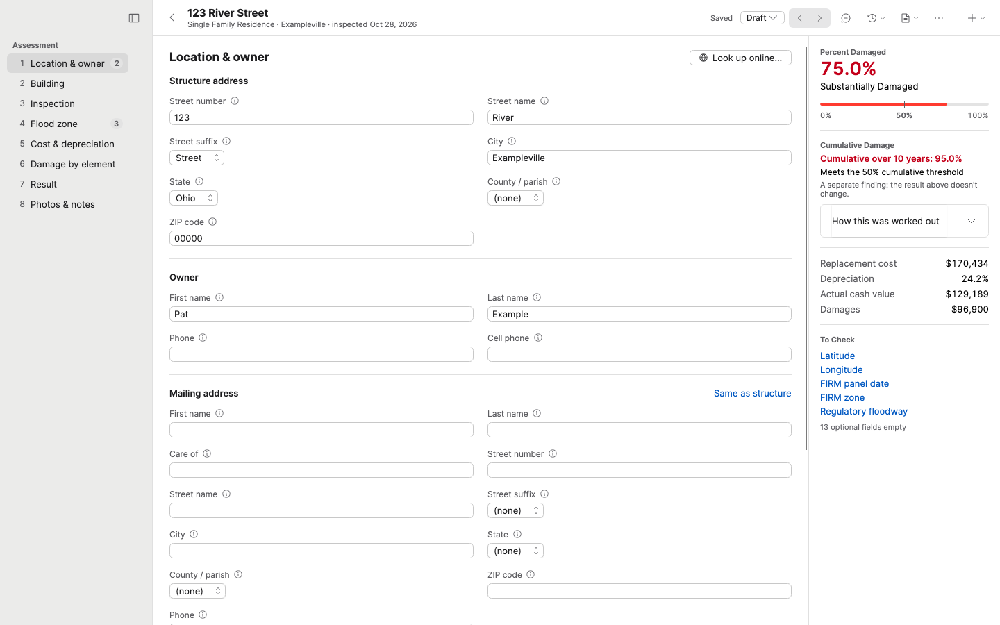

---

## 15. The phone form
Inspectors can look up or add structures, fill in assessments and take photos from a phone's web browser while SDE
runs on a Mac nearby. Nothing is installed on the phone. The full guide, including what it does and doesn't protect
against, is [Phone form](PHONE-FORM.md).

> **Use it only on a network you trust** (your organisation's Wi-Fi, or a hotspot you control). The phone form uses
> plain HTTP, so anyone watching traffic on the same network could read what is sent.

### On the Mac
1. Open **Settings > Phone form** and click **Start Phone Form**. SDE shows a QR code, an address and a 6-digit PIN.
2. The first time, macOS asks whether SDE may find devices on your local network or accept incoming connections.
   Allow it.

### On each phone
1. Join the **same Wi-Fi network** as the Mac.
2. Scan the QR code with the camera and open the link, or type the address into the browser and enter the PIN.
3. Type your name and tap **Pair**. Your name goes into the history next to each change.
4. Search for a structure or tap **Add a structure**, then fill in the steps. Each field is saved on the Mac when you
   leave it. **Add photo** takes or chooses a photo.

### When you're done
Click **Stop Phone Form**. It also stops when you quit SDE, and by itself after 12 hours. If a phone is lost, click
**Revoke** next to it.

---

## 16. AI assistants
An AI assistant such as Claude Desktop or Claude Code can work with an SDE database: find structures, read and explain
assessments, run the quality checks, summarise an event, and make reports, GeoJSON files and web maps. SDE includes the
server the assistant talks to (it uses the Model Context Protocol, MCP). The assistant runs SDE in the background; no
window opens. The developer notes, with every tool, are [MCP.md](MCP.md).

### Connecting an assistant
1. Put SDE in the **Applications** folder, and open the database in SDE once.
2. Open **Settings > AI assistants**.
3. For **Claude Code**, click **Copy Command**, paste it into Terminal and press Return. For **Claude Desktop**, click
   **Copy Setup**, then in Claude Desktop choose **Settings, Developer, Edit Config**, add it to the file and restart
   Claude Desktop.

The setup names this database. After switching to another database, copy it again.

### What an assistant may do
- **Always:** read the database, run the quality checks, list events, compliance cases and map layers, and write
  reports, GeoJSON files and web maps into an **AI outputs** folder beside the database.
- **Only after you turn on Let AI assistants change this database:** fill in fields, set Draft, Reviewed or Appeal,
  add structures, events and review comments, and assign structures to teams.
- **Never:** change a Final or Letter sent assessment, delete anything, import, export to FEMA, mark a letter sent, or
  change settings.

Every change is recorded in History under the assistant's name. Under **Recent changes by AI assistants**, **Revert**
puts back what one request changed (hold the pointer over it to see exactly what it does); anything changed again
since is left as it is.

> Treat an assistant's work like a new colleague's: check its changes before an assessment is Final. SDE tells the
> assistant that notes and other free text in the database are data, not instructions, but check its work all the
> same.

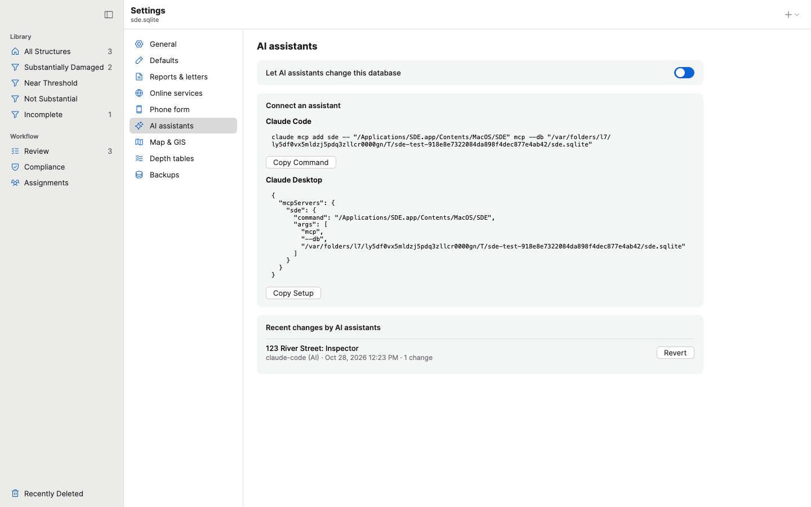

---

## 17. Backups, moving and sharing

### Automatic backups
SDE backs up the database and its photos into a `Backups` folder next to the database: once on the first opening each
day, and when you quit if anything changed. It keeps the 14 newest. Photos in backups take no extra space.

### Restoring a backup
1. Choose **File > Restore from Backup…** (or **File > Backups…**, or **Restore from Backup…** in **Settings >
   Backups**).
2. Pick the backup by its date and time.
3. SDE backs up the current state first (labelled *before restore*), so a restore can itself be undone, then reopens
   the database.

### Saving a copy
**File > Save a Copy of the Database…** saves a copy wherever you like: before a big import, or to archive the event
when it's over.

### Moving an event to another Mac
1. Quit SDE.
2. Copy the event's folder (the database file, its `attachments` folder and its `Backups` folder) to the other Mac.
3. On the other Mac, choose **File > Open Database…** and pick the database file.

### Working with colleagues
- Give each person their own database, and exchange work with **SDE export folders**
  ([3.2](#32-from-femas-sde-or-another-sde-for-mac) and [chapter 10](#exporting-for-femas-sde-or-your-state)), which
  also work with FEMA's SDE. **Keep mine**, **Replace mine** or **Keep both** decides what happens to structures you
  both have.
- Don't open the same database file from two Macs at once, for example on a shared network drive.
- For inspectors in the field, use the [phone form](#15-the-phone-form).

### Share your setup
**Import & Export > Your setup** gives colleagues your **Saved notes**, **Spreadsheet import mappings** and
**Default values**:

1. Tick what to include and click **Save Settings File…**.
2. Your colleague clicks **Import Settings File…**. Notes and mappings are added to theirs; default values replace
   theirs after they confirm.

The file is FEMA's user-settings format, so it also works with FEMA's SDE.

**Import profiles** ([3.3](#33-from-a-permit-system-spreadsheet-or-assessor-roll)) are files in
`~/Library/Application Support/SDE/Import Profiles/`, outside any database, so they carry over to the next event. On
the import page, **Show Profiles in Finder** lets you send one to a colleague, and **Use a Profile Someone Shared…**
adds one.

---

## 18. Troubleshooting

| Problem | What to do |
|---|---|
| macOS says it can't check SDE, or that it can't be opened | Follow step 6 of [Install](../README.md#step-by-step): System Settings > Privacy & Security > **Open Anyway**. |
| "was created by a newer version of this app" | Someone opened the database in a newer SDE. Update SDE. |
| An `.mdb` import says mdbtools was not found | Your copy of SDE was built without the `.mdb` readers. Use a release build, or run `brew install mdbtools`. |
| I can't change an assessment | It is **Final** or **Letter sent**. Choose another status from the status pop-up in the editor's toolbar; SDE asks for a reason. |
| I can't make an assessment Final | Some damage values are still **Suggested** from a depth table. Accept or change them on the Damage step. |
| An online look-up fails or times out | Check the internet connection and click **Try Again**. The Census and FEMA services are sometimes busy, especially right after a disaster. |
| The map has no background | The background needs an internet connection. Structures without coordinates aren't shown at all ([3.5](#35-adding-coordinates)). |
| A phone can't reach the Mac | Check both are on the same Wi-Fi. Guest networks often keep devices apart: use another network or a hotspot. On the Mac, check **System Settings > Privacy & Security > Local Network** allows SDE. |
| I deleted something by mistake | Look in **Recently Deleted** at the bottom of the sidebar (⌘7, 30 days). After that, [restore a backup](#restoring-a-backup). |
| The sidebar has gone | Click the sidebar button at the left of the toolbar, or choose **View > Hide or Show Sidebar** (⌃⌘S). |
| I can't find a page that used to be in the sidebar | Map and Summary are in the toolbar's switch (**List**, **Map**, **Summary**), Import & Export is **View > Import & Export** (⌘8), and Settings is **SDE > Settings…** (⌘,). Events are under **Events** in the sidebar and in the **Event** menu; databases are in the **File** menu. |
| A result differs from FEMA's SDE on Windows | Compare the inputs first (cost data, square footage, depreciation, adjustments, value and repair bases). If they match, please [report it](../README.md#getting-help) with the values, not the owner's details. |
| SDE shows "Something went wrong" | Click **Show details** for the technical message. **Help > Show Log Folder** opens the log files. If you report the problem, read the log first and remove anything personal. |

---

## 19. Keyboard shortcuts
The menus show each shortcut beside its command, and **Help > Keyboard Shortcuts** lists the main ones in the app.

| Shortcut | Action |
|---|---|
| ⌘N | New residential structure |
| ⇧⌘N | New non-residential structure |
| ⌘O | Open a database |
| ⌘S | Save now |
| ⌘I | Import SDE data |
| ⇧⌘I | Import inspections or parcels |
| ⌘E | Export everything to an SDE folder |
| ⌘F | Find (search the list) |
| ⌘Z / ⇧⌘Z | Undo / redo |
| ⌘1 to ⌘8 | Structures, Map, Summary, Review, Compliance, Assignments, Recently Deleted, Import & Export |
| ⌘, | Settings |
| ⌃⌘S | Hide or show the sidebar |
| ⌘K | Search structures, pages and commands |
| ⌘[ / ⌘] | Previous / next step in the editor |
| 0 to 4 | On a damage slider: 0, 25, 50, 75 or 100 percent |
| Return | Open the selected structure |
| Esc | Close the open panel |
| ⌘M | Minimise the window |
