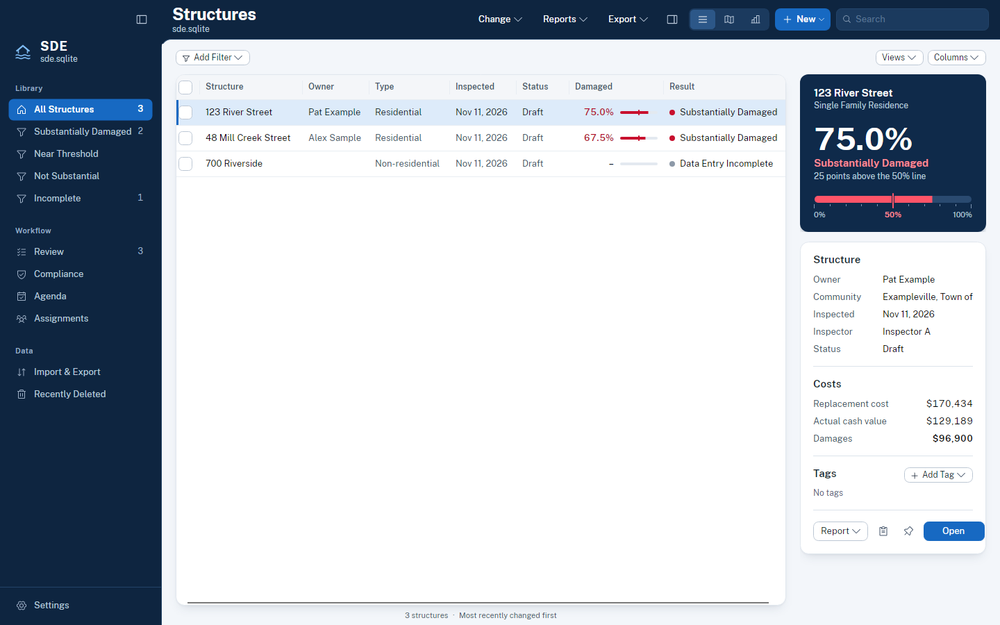

# What's new in SDE for Mac 3.5

SDE for Mac 3.5 has a new look and fifteen new features. FEMA's calculation, the exchange formats and FEMA's tables in
the database are unchanged. 3.5 opens databases from every earlier version, and 3.0 can still open a database that
3.5 has used. 3.0 keeps what it doesn't know about (tags, pinned structures, stored flood lookups) and simply doesn't
show it.

## A new look
- **A navy frame.** The sidebar and the toolbar are one deep navy frame, in light and dark, around a bright working
  area. Pages use white cards, larger titles and clearer tables.
- **The staff gauge.** Wherever a percent damaged appears, a small staff gauge shows it against the red 50 percent
  line: in the Structures table, the inspector, the editor, Summary, the phone form and the PDF reports.
- **The result up front.** The Structures inspector and the editor's right-hand panel open with the percent damaged
  in large type on navy.
- **Public Sans everywhere.** The app, the phone form and the reports now use the same typeface.
- **Appearance settings.** Settings › Appearance chooses Light, Dark or Match System, SDE's blue or the Mac's accent
  colour, and Comfortable or Compact sizes. Compact keeps the tighter 3.0 sizes and takes effect the next time SDE
  opens.
- **Sheets** share one button layout: Cancel, then the main action on the right. They dim the window behind them.

## Finding your way around
- **The sidebar** now has Library, Pinned, Saved Views, Tags, Events, Workflow and Data sections, with Settings at
  the foot. Sections with nothing in them stay hidden.
- **Drag to resize** the sidebar and the inspector. SDE remembers their widths, whether they are shown, and the
  widths of the Structures table's columns.
- **Pin a structure** from its row menu, the inspector or the editor's More menu, and it stays in the sidebar.
  Command-K lists the structures you opened recently.

## Structures
- **One filter bar.** Add Filter puts a chip on the bar for each filter, such as "Inspector: Inspector A". Click a
  chip to change it, or × to remove it.
- **Tags.** Give structures coloured tags, such as "Needs EC" or "Mailing". Tag them from the inspector, the row menu
  or Change › Tags for the checked structures. Tags have their own column, filter, sidebar section and Manage Tags
  sheet. Tags are never exported to FEMA formats.
- **Export This List.** Export › This List to CSV… or This List to Excel… writes the rows and columns you see, in
  the order you see them. The FEMA workbook export is now called FEMA Excel Workbook….
- **The Submission Folder** is a sheet. It can also include owner letters, documents, the compliance report, the
  event summary and a case file for each structure.

## Each structure
- **Case File.** One page for a structure across every event: its current result, a timeline of everything that
  happened to it, and cards for its assessments, compliance case, letters, appeals and bids, improvements, documents
  and photos. Print Case File… writes it as a PDF. Open it from the inspector, the row menu, the editor's More menu or
  Command-K.
- **Documents.** Permits, elevation certificates and other files kept with a structure can now be listed, opened,
  added and removed (More › Documents… in the editor).
- **Photo Quick Look.** Click a photo or press Space to see it large. The arrow keys step through the photos.
- **Compare Assessments.** For a structure inspected more than once, see two assessments side by side, with only the
  fields that differ.

## Workflow
- **Agenda** (new, in the sidebar's Workflow section) lists what is overdue and what is coming up, by week:
  compliance deadlines, final inspections, appeal dates, letters sent and event dates. Add to Calendar… saves the
  dates as a calendar file.
- **Review** shows the selected assessment's result, its checks with a short detail line, and its comments. Checks
  that couldn't run say so under "Not checked", with Check Online where a lookup would let them run. Flood map
  lookups are now kept with each structure, so the flood zone check runs offline once a lookup has been made.
- **Merge duplicates.** When Review finds two records for the same building, Merge… shows what would move and
  which empty fields would be filled, then merges them. Undo puts both back.
- **Compliance** has an inspector with the case's dates and timeline, and a Due soon filter.
- **Assignments** keeps its teams in a card with + and − buttons, and the other commands in one More menu.
- **Recently Deleted** is a table. Select several rows, then Restore or Delete Now, or press Delete.

## Summary and the map
- **Summary** opens with the event's headline: how many structures are substantially damaged, the building value,
  the repair cost and how much has been assessed. Two new charts show the spread of percent damaged around the 50
  percent line and progress over time.
- **The map** fills its page, with the tools, legend, zoom and selection actions floating over it. The attribute
  table is a drawer you can resize.
- **Show structures as** markers, clusters coloured by their worst result, or a heat map of damage. High-water marks
  loaded in the Depth tool can be drawn as a water surface. All three appear in map prints.

## Importing and the phone form
- **Import & Export** has three tabs: Import, Export and Field Work. Drop a database, spreadsheet or SDE folder on the
  Import tab, or anywhere on the window.
- **Several buildings in one record.** An import profile can turn one row into several structures, from a number of
  buildings or a list of units in a column. Importing the file again updates the same structures.
- **The phone form** can now enter damage by element, cost adjustments and the Draft or Reviewed status, and start a
  second assessment for a re-inspection. It uses the new look and shows the staff gauge.

## For AI assistants and the command line
- The assistant can read letters, documents, appeals and bids, improvements, a compliance case's timeline and the
  agenda. It still cannot delete, import or change a determination.
- The `sde` command line adds `events`, `qa`, `compliance` and `report`.

## Also
- **What's New** shows once after an update, and from Help › What's New in SDE.
- **Help › Check for Updates…** asks GitHub for the latest release, only when you choose it. Nothing checks on its
  own.
- **Accessibility.** SDE follows the Mac's Reduce Motion and Increase Contrast settings, and every control can be
  reached with the keyboard.
- **Dates** are typed in a plain date field ("11/11/2026" works), with a calendar button beside it.
- **Online services** were checked against the live FEMA, USGS and Census services. USGS event types and FEMA's
  blank flood zone subtypes are now read correctly.

## Where things moved

| In 3.0 | In 3.5 |
|---|---|
| Type and Source pop-ups and the Filters pop-up above Structures | Add Filter and a chip for each filter |
| The Submission Folder panel above the table | A sheet, from Export › Submission Folder… |
| Export › Excel… | Export › FEMA Excel Workbook… |
| Import & Export as one long page | Three tabs: Import, Export and Field Work |
| Import & Export and Settings with no sidebar row | Import & Export in the sidebar's Data section; Settings at the foot of the sidebar |
| Recently Deleted docked at the bottom of the sidebar | The sidebar's Data section |
| The version in Settings › General | Settings › About |
| Clicking a photo opened it in Preview | Clicking a photo opens Quick Look; Open in Preview is in its menu |
| Review and Compliance filters in the toolbar | A filter bar above the table |
| Assignments' five toolbar buttons | Order Route and Route Sheet…, with the rest in More |
| Compliance's EC Received and Final Inspection columns | The Compliance inspector |

The page shortcuts are unchanged: ⌘1 Structures, ⌘2 Map, ⌘3 Summary, ⌘4 Review, ⌘5 Compliance, ⌘6 Assignments, ⌘7
Recently Deleted, ⌘8 Import & Export. Agenda has no number.
